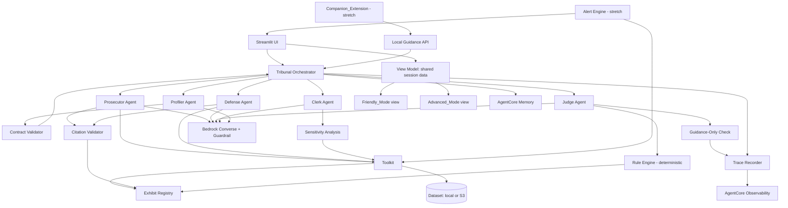
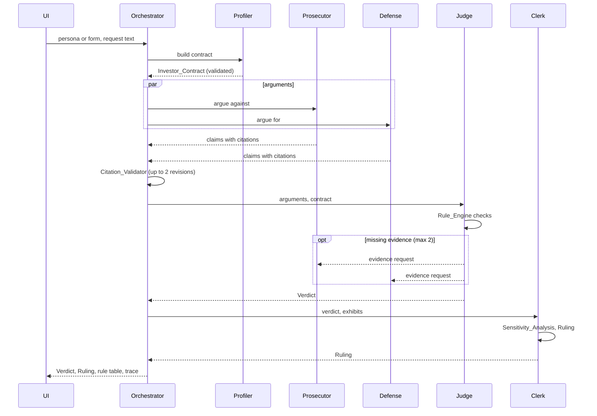

# Design Document

## Overview

The Agentic Investment Guide is a simulation-only multi-agent system. The MVP is the Decision Tribunal: five agents (Profiler, Prosecutor, Defense, Judge, Clerk) evaluate one Investment_Request against an Investor_Contract. The implementation language is Python 3.11, with Streamlit for the UI, boto3 for AWS, pandas for data, and `jsonschema` and `hypothesis` for validation and property tests.

The Guide_System is a guidance website. It only guides: it never places, routes, prefills, or triggers an order, transfer, or brokerage or bank action, and it holds no brokerage or bank credentials. The UI offers two modes over the same data: a Friendly_Mode (default) with a courtroom scene and short plain-language summaries, and an Advanced_Mode with full detail.

Five design principles drive the structure:

1. **Numbers come only from code.** Deterministic Toolkit functions read the Dataset and emit immutable, numbered Exhibits. Agents cite Exhibits and never compute figures.
2. **Verdicts come from code.** The Judge's pass/fail per rule and the Verdict are computed deterministically. The language model only writes narrative.
3. **Citations are enforced.** A Citation_Validator rejects any claim without a valid Exhibit reference or whose numbers differ from the Exhibit.
4. **Agents are thin.** Prosecutor and Defense are two role prompts over one shared Toolkit and one Exhibit_Registry. The orchestrator is plain Python, not a separate service.
5. **Guidance only, enforced in four layers.** The Bedrock Guardrail, a deterministic Judge check, a static code and configuration scan in the test suite, and a UI with no action controls each block the Guidance_Only_Rule independently. The system contains no brokerage or bank client and no credential fields.

The Flight Simulator (Requirement 12), the Companion_Extension (Requirement 14), and Alerts (Requirement 15) are optional extensions. They reuse the Toolkit with an `as_of` parameter and the same Tribunal pipeline. Each is described in a separate section and can be left out without affecting the MVP.

### Technology choices

| Concern | Choice | Reason |
| --- | --- | --- |
| LLM access | Amazon Bedrock Converse API with tool use | Required by Req. 8.1, 2.8 |
| Safety | Bedrock Guardrails | Enforces Challenge_Rules (Req. 5.7) |
| Memory | AgentCore Memory | Stores contracts and summaries (Req. 8.4) |
| Observability | AgentCore Observability (OpenTelemetry) plus local JSON trace | Req. 8.3, 9.4 |
| Data | pandas over CSV, local or S3 | Req. 8.5, 8.6 |
| UI | Streamlit, with `st.session_state` shared by both modes | Req. 7 |
| Local guidance API (stretch) | FastAPI on localhost, one endpoint | Req. 14.3 |
| Tests | pytest and hypothesis | Req. 10, 13.8, 13.9 |

## Architecture



### Session flow



### Module layout

```
guide/
  config.py            # region, model id, guardrail id, bucket, data location, macro lags
  data/loader.py       # local or S3 reader
  data/quality.py      # CNQ note, survivorship text, unsupported-topic detection
  contract/schema.json
  contract/profiler.py
  contract/validate.py
  toolkit/exhibits.py  # Exhibit, ExhibitRegistry
  toolkit/metrics.py   # return, volatility, drawdown, correlation, portfolio
  toolkit/align.py     # FX conversion, calendar alignment, as_of filter, macro lag
  toolkit/tools.py     # Converse tool specs
  agents/base.py       # Bedrock client wrapper, retry, guardrail
  agents/prosecutor.py, defense.py, judge.py, clerk.py
  tribunal/orchestrator.py
  tribunal/citations.py
  tribunal/rules.py
  tribunal/sensitivity.py
  tribunal/request_parser.py
  tribunal/guidance_only.py  # Judge-side Guidance_Only_Rule check and statement removal
  tribunal/summaries.py      # plain-language summaries, at most 60 words
  trace/recorder.py
  ui/app.py
  ui/view_model.py     # SessionView: one data object read by both modes
  ui/friendly.py       # courtroom scene, agent highlight, summaries
  ui/advanced.py       # exhibits, rule table, sensitivity, trace, JSON export
  flight/             # optional stretch
  alerts/engine.py    # optional stretch: Market_Event detection and Alerts
  companion/          # optional stretch
    api.py            # local guidance API
    extension/        # side-panel script
    sim_brokerage/    # simulated brokerage page
tests/
  test_guidance_scan.py  # static scan of source and configuration
```

## Components and Interfaces

### Config (Req. 8.7, 3.5)

Loaded from environment variables and `config.yaml`. Contains `aws_region`, `model_id`, `guardrail_id`, `guardrail_version`, `s3_bucket`, `data_location` (`local` or `s3`), `data_dir`, and `macro_publication_lag_days` (series_id to days). No credential fields exist. A log filter redacts values matching AWS key patterns.

### Data loader (Req. 8.5, 8.6)

```python
class DataSource(Protocol):
    def read_csv(self, name: str) -> pd.DataFrame: ...

class LocalSource: ...   # reads /workshop/Agent52/data
class S3Source: ...      # reads s3://{bucket}/{prefix}/{name}
```

### Contract and Profiler (Req. 1)

```python
class Provenance(str, Enum):
    PERSONA = "persona"; FORM = "form"; DEFAULT = "default"

class InvestorContract(TypedDict):
    risk_level: Literal["low", "moderate", "high"]
    horizon_years: float
    max_volatility: float          # annualized, fraction
    max_drawdown: float            # fraction, positive
    per_asset_cap: float
    per_asset_class_caps: dict[str, float]
    crypto_cap: float
    sector_caps: dict[str, float]
    esg_exclusions: list[str]
    speculative_limit: float | None
    provenance: dict[str, Provenance]

def build_contract_from_persona(name: str) -> InvestorContract
def build_contract_from_form(values: dict) -> InvestorContract
def validate_contract(c: dict) -> list[FieldError]   # empty list means valid
```

Persona definitions live in `personas.yaml`, derived from `context.md`. Amira gets a per-asset-class cap and a minimum-diversification rule. Mateo gets ESG exclusions and a speculative limit. Robert gets horizon 3 to 5 years and a low crypto cap. Fields absent from a form take stated defaults and are marked `default` in `provenance`. The Profiler uses the model only to map free text into form values. Schema validation is `jsonschema` against `schema.json`.

### Exhibits and Registry (Req. 2.2, 2.3)

```python
@dataclass(frozen=True)
class Exhibit:
    number: int
    metric: str
    value: float | dict          # JSON-serializable, stored read-only
    period_start: date
    period_end: date
    assets: tuple[str, ...]
    currency: str
    source_files: tuple[str, ...]
    processing_notes: tuple[str, ...]
    inputs: Mapping                # arguments used, for determinism checks

class ExhibitRegistry:
    def add(self, **fields) -> Exhibit     # assigns next sequential number
    def get(self, number: int) -> Exhibit | None
    def all(self) -> list[Exhibit]
```

The dataclass is frozen and uses tuples and a read-only mapping, so mutation raises an error.

### Toolkit (Req. 2, 3)

All functions take `registry`, `as_of: date | None`, and return `Exhibit | ToolError`. A `ToolError` never touches the registry.

```python
annualized_return(registry, ticker, start, end, as_of=None, display_ccy="CAD")
annualized_volatility(registry, ticker, start, end, as_of=None, display_ccy="CAD")
max_drawdown(registry, ticker, start, end, as_of=None, display_ccy="CAD")  # value, peak_date, trough_date
correlation(registry, ticker_a, ticker_b, start, end, as_of=None, display_ccy="CAD")
drawdown_in_period(registry, ticker, period_name_or_range, as_of=None)
portfolio_metrics(registry, weights: dict[str, float], start, end, as_of=None)
```

Shared pipeline, in order:

1. Validate tickers against `assets_universe.csv`; unknown ticker gives `ToolError(UNKNOWN_TICKER, ticker)`.
2. Filter observations to `date <= as_of` (prices, FX, macro).
3. Convert USD-listed prices to CAD with `usdcad`; for missing FX dates carry the last earlier rate. Record both actions in notes.
4. Align assets on the intersection of dates. Record the method and count in notes.
5. If any asset has fewer than 20 observations, return `ToolError(INSUFFICIENT_DATA)`.
6. Compute from `adj_close` daily simple returns.
7. If `CNQ.TO` is involved and the period includes 2022-08-22, append the split-anomaly note.
8. Register and return the Exhibit.

Macro series access (`macro_value(series_id, as_of)`) returns the latest value whose reference date plus the configured lag is on or before `as_of`.

Each function has a Converse tool spec (`toolSpec` with `inputSchema.json`) generated from its signature in `tools.py`. The tool runner dispatches a `toolUse` block, calls the function, and returns the Exhibit number and value in `toolResult`.

### Citation Validator (Req. 4.3 to 4.6)

```python
@dataclass
class Claim:
    text: str
    citations: list[int]
    numbers: list[NumberRef]   # (value, exhibit_number, field)

def validate_claim(claim, registry, tol=1e-4) -> list[CitationIssue]
def enforce(agent, claims, registry, max_revisions=2) -> tuple[list[Claim], list[TraceEvent]]
```

Agents return claims as structured JSON (`text`, `citations`, `numbers`). `validate_claim` fails when `citations` is empty, a number is absent from the registry, or a stated number differs from the Exhibit value beyond rounding tolerance. `enforce` returns failing claims to the agent up to 2 times, then drops them and records the removal.

### Rule Engine and Judge (Req. 5)

```python
@dataclass
class RuleResult:
    rule: str
    status: Literal["pass", "fail", "unverified"]
    observed: float | None
    limit: float | None
    exhibits: list[int]

def evaluate_rules(contract, request, registry) -> list[RuleResult]
def decide(results, contract, request, registry) -> Verdict
```

Rules checked: per-asset cap, per-asset-class cap, crypto cap, sector cap, maximum volatility (portfolio), maximum drawdown, ESG exclusion (unverified when scores are absent), speculative limit. `decide` works as follows:

- All rules pass: `accept`.
- Some fail: compute the largest position size at which every failed rule passes (bisection over position size using `portfolio_metrics`). If that size is greater than 0, return `accept_with_conditions` with a numeric maximum position. Otherwise return `reject`.
- Rules with no evidence produce an evidence request to Prosecutor or Defense, at most twice per session. Rules still lacking evidence are listed as `unverified`.
- If the Persona risk level is low to moderate and the request exceeds the per-asset cap, the Verdict records a tension statement.

The Judge Agent receives the computed results and writes only the narrative.

#### Guidance-only check (Req. 5.11, 5.12, 13)

```python
@dataclass
class GuidanceFinding:
    agent: str
    statement: str
    passed: bool
    matched_pattern: str | None

def check_guidance_only(agent: str, statements: list[str]) -> list[GuidanceFinding]
def strip_violations(ruling, findings) -> tuple[Ruling, list[TraceEvent]]
```

`check_guidance_only` is deterministic. It matches each statement against a pattern list covering imperative order or transfer instructions ("place the order", "transfer funds", "execute the trade"), simulated execution ("order submitted", "trade confirmed"), and prefill or trigger language ("prefilled order ticket", "one-click buy"). The Judge runs it on every Prosecutor, Defense, and Clerk output and records one pass or fail event per output in the Trace. `strip_violations` removes failing statements from the Ruling and records each removal. When a failure occurs, the UI shows a message that the Guide_System only provides guidance.

#### Guidance-only layers (Req. 13)

| Layer | Mechanism | Requirement |
| --- | --- | --- |
| Guardrail | Denied topics for real orders, transfers, and brokerage or bank actions on model input and output | 13.5 |
| Judge check | `check_guidance_only` and `strip_violations`, traced | 5.11, 5.12, 13.6 |
| Static scan | Test that scans source and configuration for brokerage or bank API clients and credential patterns | 13.2 to 13.4, 13.9 |
| UI | No widget whose callback places, routes, prefills, or triggers an action; a persistent guidance-only statement | 7.18, 7.19 |

The Clerk template phrases every recommendation-like statement as "You may wish to consider ... and decide personally" (Req. 13.7). The statement is template text, not model text. The README, technical documentation, and one-page summary each state the Guidance_Only_Rule (Req. 13.10).

### Clerk and Sensitivity (Req. 6)

```python
def sensitivity(contract, request, registry) -> list[SensitivityResult]
# varies position size, horizon, and the 2022 drawdown period
# each result: varied_input, threshold | None, tested_range, exhibit_number
```

Position size threshold uses the same bisection as the Judge. Horizon changes the drawdown tolerance check: it re-evaluates the horizon-dependent rules at each tested horizon. The 2022 period uses `drawdown_in_period`. Each result is stored as an Exhibit. The Clerk assembles the Ruling from a template with sections Facts, Assumptions, Fictional scenarios, Limits, and "What would change the verdict". Recommendation-like statements use the guidance phrasing described under the guidance-only layers. The disclaimers, the survivorship-bias text, and the unsupported-topic notice are inserted by code, so the model cannot omit them. Facts statements carry Exhibit numbers via the Citation_Validator.

### Request Parser (Req. 7.10)

```python
def parse_request(text: str, universe: set[str]) -> ParsedRequest | MissingFields
# ParsedRequest: ticker, weight_fraction
# MissingFields: {"asset": bool, "size": bool}
```

Rule-based extraction with a model fallback. The result is always checked against the universe.

### Agent base and Bedrock wrapper (Req. 8.1, 8.2, 8.8)

```python
class BedrockAgent:
    def run(self, system_prompt, messages, tools, trace) -> AgentOutput
```

Every call uses `bedrock-runtime.converse` with `guardrailConfig`. The wrapper retries `ThrottlingException` up to 3 times with exponential backoff and jitter, then raises `StageFailure(stage)`. A guardrail intervention (`stopReason == "guardrail_intervened"`) is recorded in the Trace and mapped to the Challenge_Rule that applied.

### Trace Recorder (Req. 9)

```python
class TraceRecorder:
    def agent_call(self, agent, input_summary, output_summary)
    def tool_call(self, name, args, exhibit_number)
    def judge_check(self, rule, inputs, result)
    def guardrail_block(self, stage, rule)
    def claim_removed(self, agent, claim)
    def export_json(self) -> str
```

Events carry a timestamp and sequence number. Only summaries are stored, never raw model reasoning. Events are also emitted as OpenTelemetry spans to AgentCore Observability. A link-chain function `trace_chain(statement)` returns statement, Exhibit numbers, and `source_files`.

### Memory (Req. 8.4)

`MemoryStore.save_contract(profile_id, contract)`, `save_summary(profile_id, summary)`, and `load_contract(profile_id)` wrap AgentCore Memory.

### UI (Req. 7)

`ui/app.py` has a sidebar with the persona picker (Amira, Mateo, Robert), the custom form (risk level, horizon, maximum volatility, maximum drawdown, per-asset cap, crypto cap, ESG exclusions), a free-text request box, and a mode switch. Two statements stay visible in both modes: a simulation banner (`st.warning`, "simulation, not financial advice") and a guidance-only statement ("this tool only provides guidance; you act personally outside it"). Stage progress uses `st.status`. Inputs live in `st.session_state`, so a stage failure leaves them intact, and the error shows the failing stage name. Unparsable requests trigger a prompt for the missing asset or size.

#### Shared view model and mode switching (Req. 7.9, 7.14 to 7.17)

```python
@dataclass
class SessionView:
    mode: Literal["friendly", "advanced"]       # default "friendly"
    contract: InvestorContract | None
    stage: str                                  # current or last stage
    active_agent: str | None
    exhibits: list[Exhibit]
    verdict: Verdict | None
    ruling: Ruling | None
    rule_results: list[RuleResult]
    sensitivity: list[SensitivityResult]
    trace: list[TraceEvent]
    summaries: dict[str, str]                   # agent -> plain-language summary
    focus: FocusTarget | None                   # exhibit, rule, or trace entry to open in Advanced_Mode
```

Both `ui/friendly.py` and `ui/advanced.py` are pure render functions of one `SessionView` stored in `st.session_state["view"]`. The mode switch changes only `view.mode`. It does not call the orchestrator, so a running or finished Tribunal_Session continues without restart, and no data is copied per mode. Because both renderers read the same Exhibits, Verdict, and Ruling objects, the values shown are identical across modes. A running session executes stage by stage and writes each stage output into the view on completion, so a switch between stages preserves progress.

#### Friendly_Mode (Req. 7.10 to 7.12, 7.17)

- A courtroom scene (SVG or HTML via `st.components`) with four seats: Prosecutor, Defense, Judge, Clerk. The seat of `view.active_agent` gets a highlight style.
- After each stage, `summaries.py` produces a plain-language summary of at most 60 words for that agent. The summary is built from the stage's structured output (counts of claims, rule results, threshold values) with a template, and the model may only rephrase it; `summarize` truncates at a sentence boundary so the limit always holds. Numbers in a summary come from Exhibits and each statement keeps its Exhibit link.
- The Verdict and the answer to "What would change the verdict" appear in plain language, each statement with an `[Exhibit N]` link.
- A "See details" control sets `view.focus` to the Exhibit, rule, or Trace entry and switches to Advanced_Mode, which scrolls to and expands that item.

#### Advanced_Mode (Req. 7.6, 7.7, 7.13)

Shows the full Exhibit list, the per-rule pass or fail table with observed values and limits, the Sensitivity_Analysis results, the Trace panel (ordered agent calls, tool calls, Exhibits created, Judge checks, Guardrail blocks), and a download button for the Trace JSON. Exhibit citations in arguments and the Ruling render as clickable elements that open the Exhibit fields.

#### No action controls (Req. 7.18, 7.19, 13.2)

The UI contains only input widgets for profile and request text, mode switch, Exhibit and Trace navigation, and a Trace download. It has no widget whose callback contacts a brokerage or bank, creates an order object, or produces a prefilled order. A test inspects the Streamlit element tree (AppTest) and the callbacks' module imports to confirm this.

### AWS deployment (Req. 8.9)

Least-privilege IAM: `bedrock:InvokeModel` and `bedrock:ApplyGuardrail` scoped to the model and Guardrail ARNs; `s3:GetObject` on the data prefix only; AgentCore Memory read/write on the one memory resource; CloudWatch/X-Ray write for traces. Guardrail denied topics: real-trade instructions, instructions or simulated execution of any order, transfer, or brokerage or bank action, personalized financial advice, return predictions. The IAM policy contains no permission for any brokerage or bank service, and the configuration holds no brokerage or bank credential fields.

### Companion_Extension (optional, Req. 14)

Components:

- `companion/sim_brokerage/`: a static local page (`localhost`) with a ticker field and a position-size field, a mock "order" area that does nothing, and no account data, credentials, or real institution link.
- `companion/extension/`: a content script plus side panel. The script is limited to the simulated page origin through `matches` in the manifest. It reads only the two user-entered input values (ticker and size) through their element ids. It never reads other fields, cookies, storage, or account text, and never writes to the page DOM outside its own side-panel iframe.
- `companion/api.py`: a local FastAPI app bound to `127.0.0.1` with one endpoint.

```python
class GuidanceRequest(BaseModel):
    ticker: str
    size: str            # raw user text, parsed server-side

class GuidanceResponse(BaseModel):
    verdict: Literal["reject", "accept", "accept_with_conditions"]
    summary: str         # plain language, at most 60 words
    session_url: str     # link that opens the full Tribunal_Session in the UI
    banner: str          # simulation, not advice, user acts personally

def parse_companion_input(ticker: str, size: str, universe: set[str]) -> ParsedRequest | MissingFields
```

Flow: when both fields have been entered, the side panel posts the two values to `POST /guidance`. The API runs `parse_companion_input` (the same parser as the UI). If the ticker or size is missing or unparsable, the API returns HTTP 422 with the names of the missing values and runs no session; the panel shows the message and sends no request. Otherwise it runs the Tribunal pipeline for the active contract and returns `GuidanceResponse`. The panel always shows the banner and the link. The API accepts no other fields (extra fields are rejected by the model), so account data cannot reach the Guide_System even if sent. CORS allows only the simulated page origin.

### Alerts (optional, Req. 15)

```python
@dataclass(frozen=True)
class MarketEvent:
    ticker: str
    date: date
    kind: Literal["single_day_move", "portfolio_drawdown"]
    magnitude: float

@dataclass(frozen=True)
class Alert:
    ticker: str
    event_date: date
    exhibit_number: int
    summary: str                 # plain language
    session_link: str            # opens a Tribunal_Session for the position
    labels: tuple[str, ...]      # guidance, simulation, not personalized financial advice
    data_basis: str              # "based on the Dataset, not live news or live market data"

def detect_market_events(prices, as_of, day_move_threshold, drawdown_threshold, universe) -> list[MarketEvent]
def build_alerts(events, portfolio, registry, as_of) -> list[Alert]
```

`detect_market_events` is pure and uses only observations dated on or before `as_of`. Thresholds come from `config.yaml`. `build_alerts` keeps only events whose ticker is held in the Simulated_Portfolio (a portfolio drawdown event applies to the portfolio itself). For each kept event it calls a Toolkit function to create the quantifying Exhibit, fills the labels and data basis from constants, and records the Alert in the Trace with the Exhibit number. Alert summary text is built from a template that contains no buy, sell, or transfer instruction, and passes through `check_guidance_only`. The UI shows each Alert as a notification: the plain-language summary in Friendly_Mode, and the underlying Exhibit in Advanced_Mode.

### Flight Simulator (optional, Req. 12)

- `flight/engine.py`: week-by-week replay from 2021-11-12. State is portfolio holdings and cash. Every data access passes `as_of`.
- Toolkit additions: `portfolio_value(holdings, as_of)`, `market_snapshot(as_of)`, `detect_stress_events(holdings, start, as_of, threshold)`.
- `detect_stress_events` is a pure function: a Stress_Event occurs when drawdown from the prior peak exceeds the configured threshold.
- Flight_Director pauses at a Stress_Event. Copilot explains with Exhibits computed as of that date and asks hold, sell, or buy more.
- Behavior_Analyst logs each decision with date and drawdown. At session end it compares the contract `max_drawdown` with the drawdown at the first sell and proposes an updated contract. The update is stored in AgentCore Memory only after explicit user approval.

### Tribunal extensions (Req. 16 to 21)

These extensions make the debate decide something, add the two differentiating mechanisms (appeal and precedents), and complete the AWS deployment.

**Base portfolios and risk contribution (Req. 16).** `personas.yaml` gains a `base_portfolio` per Persona. Example for Robert (fictional): XBB.TO 40 %, ZST.TO 15 %, XIU.TO 15 %, SPY 15 %, JNJ 8 %, RY.TO 7 %. `proposed = {t: w*(1-x) for t, w in base} + {asset: x}`. New tools:

```python
risk_contribution(registry, weights, start, end) -> Exhibit   # % of variance per asset, CAD
portfolio_comparison(registry, base, proposed, start, end) -> Exhibit
# vol, max drawdown, worst rolling 252-day return, 2022 return, annualized return, for both
```

Reference values computed on the starter data (CAD, daily rebalanced, 2021-11-12 to 2026-11-12) for Robert's base portfolio:

| Portfolio | Vol | Max DD | Worst 12 m | 2022 | Ann. return |
|---|---|---|---|---|---|
| Base | 6.2 % | -10.4 % | -6.2 % | -6.1 % | 8.1 % |
| +5 % TSLA | 7.5 % | -12.2 % | -9.5 % | -9.5 % | 8.8 % |
| +30 % TSLA | 19.5 % | -31.0 % | -27.7 % | -25.8 % | 11.0 % |

At 30 %, TSLA carries 87 % of portfolio variance. These values are a test oracle for the toolkit.

**Hard rules and soft preferences (Req. 17).** `InvestorContract` gains `soft_preferences: list[SoftPreference]` with `id`, `text`, `source` (persona or form). Flow in `decide`:

1. `evaluate_rules` on Hard_Rules (code). Fail with no feasible numeric condition: `reject`, stop.
2. Otherwise the Judge model receives `{"party_a": ..., "party_b": ...}` (random order, role names removed, each argument capped at the same token budget) and the list of Soft_Preferences, and returns JSON `[{preference_id, assessment: "satisfied"|"tension"|"not_satisfied", deciding_party, exhibits}]`.
3. Any `not_satisfied` soft preference downgrades `accept` to `accept_with_conditions` (with a narrative condition) but can never upgrade a hard-rule result. Conflicts are traced.

**Appeal (Req. 18).** `tribunal/appeal.py`: `appeal(session, change: AppealChange) -> Session` copies the original session inputs, applies one change, reruns Toolkit, rules, Judge, and Clerk, and returns a new session. `diff_sessions(a, b)` returns changed rules, changed Exhibits, and both Verdicts. The UI shows them side by side.

**Precedents (Req. 19).** `tribunal/precedents.py` with `PrecedentStore` (DynamoDB table `verdict-precedents`, partition key `asset`, sort key `session_id`; local JSON fallback). `closest(asset, weight)` returns the precedent with the nearest weight. The Judge prompt receives it and must name the contract field that explains a different verdict (for example `max_drawdown` 0.12 versus 0.40).

**ESG source (Req. 20).** `data/esg_exclusions.csv` with `ticker, excluded, reason, source_url, retrieved`. Built by hand for the 31 assets from a cited public methodology; documented in `docs/data_sources.md`. The rule `esg_exclusion` becomes a Hard_Rule when the contract lists exclusions.

**Deployment (Req. 21).** Dockerfile for the Streamlit app; App Runner service with an instance role (Bedrock invoke and guardrail, S3 read on the data prefix, DynamoDB read and write on the precedents table, AgentCore Memory, CloudWatch). Architecture diagram in the README.

## Data Models

### Investor_Contract JSON (excerpt)

```json
{
  "risk_level": "low",
  "horizon_years": 4,
  "max_volatility": 0.15,
  "max_drawdown": 0.15,
  "per_asset_cap": 0.10,
  "per_asset_class_caps": {"crypto": 0.05, "equity": 0.70},
  "crypto_cap": 0.05,
  "sector_caps": {"Technology": 0.25},
  "esg_exclusions": [],
  "speculative_limit": null,
  "provenance": {"risk_level": "persona", "horizon_years": "persona", "max_volatility": "default"}
}
```

### Exhibit JSON

```json
{
  "number": 3,
  "metric": "max_drawdown",
  "value": {"drawdown": 0.62, "peak": "2021-11-04", "trough": "2023-01-03"},
  "period_start": "2021-11-12",
  "period_end": "2026-11-12",
  "assets": ["TSLA"],
  "currency": "CAD",
  "source_files": ["prices_daily.csv", "fx_usdcad_daily.csv"],
  "processing_notes": ["USD to CAD via usdcad", "FX carry-forward on 12 dates"]
}
```

The values above are illustrative. Real Exhibits hold computed values.

### Verdict

```python
@dataclass
class Verdict:
    outcome: Literal["reject", "accept", "accept_with_conditions"]
    rule_results: list[RuleResult]
    conditions: list[Condition]      # numeric, e.g. max_position_pct
    unverified_rules: list[str]
    tension: str | None
    narrative: str
```

### Trace JSON

An ordered array of events: `{seq, ts, type, agent|tool|rule, summary, exhibit_numbers, status}`.

## Error Handling

| Condition | Behavior |
| --- | --- |
| Contract fails schema | Show failing fields, do not start session (Req. 1.4) |
| Unknown ticker | `ToolError` naming the ticker, no Exhibit (Req. 2.6) |
| Under 20 observations | `ToolError(INSUFFICIENT_DATA)`, no Exhibit (Req. 2.7) |
| Missing FX rate | Carry forward last rate, note in Exhibit (Req. 3.2) |
| Claim without valid citation | Revise up to 2 times, then remove and trace (Req. 4.4, 4.5) |
| Missing evidence for rule | Up to 2 evidence requests, then `unverified` (Req. 5.5, 5.6) |
| Guardrail block | Trace entry, UI message naming the Challenge_Rule (Req. 5.8) |
| Bedrock throttling | Retry 3 times with exponential backoff, then stage failure (Req. 8.8) |
| Stage failure | UI shows stage and message, keeps inputs (Req. 7.9) |
| Unparsable request | UI asks for missing asset or size (Req. 7.10) |
| ESG, news, or fundamentals requested | State Dataset lacks it; label related arguments as unsupported (Req. 3.9) |
| Guidance_Only_Rule violation (Guardrail or Judge) | Block or strip the output, trace entry, UI message that the Guide_System only provides guidance (Req. 13.6, 5.12) |
| Summary longer than 60 words | `summarize` truncates at a sentence boundary before display (Req. 7.11) |
| Mode switch during a running session | No restart; only `view.mode` changes (Req. 7.14) |
| Companion input missing or unparsable | HTTP 422 naming the missing value, no session, no request sent (Req. 14.9) |
| Market_Event on an asset not held | No Alert created (Req. 15.9) |

## Correctness Properties

A correctness property is a statement that should hold across all valid executions of the system. Properties link the human-readable requirements to machine-verifiable checks.

Reflection notes: contract creation, schema validity, and provenance (1.1 to 1.3, 1.5) are merged into one property, with invalid-contract rejection kept separate. Exhibit completeness, numbering, and immutability (2.2, 2.3) are one property. Toolkit determinism (2.4) and Judge determinism (5.9) stay separate because they test different layers. Trace criteria 9.1 to 9.3 and 9.5 are one property. Ruling structure and disclaimers (6.1, 6.4, 6.8, 6.9) are one property. Guidance-only checks (5.11, 5.12, 13.6) are one property. Mode data equality (7.12, 7.15) is one property. Companion response criteria (14.3, 14.7, 14.8) and alert construction criteria (15.2, 15.3, 15.6, 15.8, 15.9, 15.10) are merged. Layout and browser behavior (7.1 to 7.3, 7.8 to 7.10, 14.1, 14.5) are example or integration tests.

### Property 1: Contract validity and provenance

For any persona name or any valid form input, the produced Investor_Contract passes schema validation, every contract field has a provenance value from persona, form, or default, and fields supplied by the form carry the supplied values.

**Validates: Requirements 1.1, 1.2, 1.3, 1.5**

### Property 2: Invalid contracts are rejected with failing fields

For any contract that violates the schema, validation returns a non-empty list naming each violating field, and the orchestrator does not start a Tribunal_Session.

**Validates: Requirements 1.4**

### Property 3: Exhibit completeness, sequencing, and immutability

For any sequence of successful Toolkit calls, the registry holds one Exhibit per call, numbered 1..n in call order, each with all required fields populated, and any attempt to modify a stored Exhibit raises an error.

**Validates: Requirements 2.2, 2.3**

### Property 4: Toolkit determinism

For any Toolkit function and any valid inputs, calling the function twice with identical inputs returns identical values.

**Validates: Requirements 2.4**

### Property 5: Toolkit errors create no Exhibit

For any ticker absent from assets_universe.csv, or any period with fewer than 20 observations for an asset, the Toolkit returns an error identifying the problem and the registry size is unchanged.

**Validates: Requirements 2.6, 2.7**

### Property 6: Returns are computed from adj_close

For any price series, the annualized return and volatility reported by the Toolkit equal the values computed independently from the adj_close column, and are unchanged when the close column is altered.

**Validates: Requirements 2.5**

### Property 7: Currency conversion and FX carry-forward

For any mixed-currency price set and FX series with arbitrary gaps, CAD prices equal the native price times the most recent FX rate on or before that date, and the Exhibit notes record the conversion and any carry-forward.

**Validates: Requirements 3.1, 3.2**

### Property 8: Calendar alignment is the date intersection

For any set of assets with differing trading dates, the aligned dataset contains exactly the dates present for all assets, and the Exhibit records the alignment method and the resulting observation count.

**Validates: Requirements 3.3**

### Property 9: Macro publication lag

For any monthly macro series, reference month, lag, and As_Of_Date, the series value for that month is returned if and only if the reference month plus lag is on or before the As_Of_Date.

**Validates: Requirements 3.4**

### Property 10: As-of exclusion (no look-ahead)

For any Toolkit function, inputs, and As_Of_Date, the result is unchanged when every price, FX, and macro observation dated after the As_Of_Date is altered or removed.

**Validates: Requirements 3.6, 12.2**

### Property 11: CNQ.TO anomaly note

For any Exhibit that involves CNQ.TO and whose period includes 2022-08-22, the processing notes contain the split-anomaly note.

**Validates: Requirements 3.7**

### Property 12: Claim validation and revision bound

For any set of claims and any Exhibit registry, every claim in the final argument cites at least one Exhibit that exists in the registry and states numbers matching the cited Exhibit values; each failing claim is revised at most 2 times and, if still invalid, removed and recorded in the Trace.

**Validates: Requirements 4.1, 4.2, 4.3, 4.4, 4.5, 4.6**

### Property 13: Judge determinism and verdict consistency

For any Investor_Contract, request, and set of Exhibits, the rule results and Verdict are identical across repeated runs and independent of model narrative text. The Verdict is `accept` only if all rules pass, and `reject` if any rule fails and no position size above zero satisfies all failed rules.

**Validates: Requirements 5.1, 5.2, 5.4, 5.9**

### Property 14: Conditions are numeric and sufficient

For any request that receives `accept_with_conditions`, every condition is a numeric limit, and re-evaluating the contract with the request reduced to the limit yields all rules passing.

**Validates: Requirements 5.3**

### Property 15: Evidence requests are bounded

For any Judge run with missing evidence, at most 2 evidence requests are issued per session, and every rule still lacking evidence afterward appears as unverified in the Verdict.

**Validates: Requirements 5.5, 5.6**

### Property 16: Ruling structure and citations

For any Verdict and Exhibit set, the Ruling contains the sections Facts, Assumptions, Fictional scenarios, Limits, and "What would change the verdict", every Facts statement cites an existing Exhibit, the simulation, no-advice, and no-prediction statements are present, the survivorship-bias limitation is present when dataset-derived Exhibits are used, and it references at least one factor besides volatility.

**Validates: Requirements 3.8, 6.1, 6.2, 6.4, 6.8, 6.9**

### Property 17: Sensitivity thresholds flip the Verdict

For any Investor_Contract and request, each threshold reported by the Sensitivity_Analysis changes the Verdict when applied just past the threshold and leaves it unchanged just before, and an input with no reported threshold shows no change across its tested range.

**Validates: Requirements 6.5, 6.6, 6.7**

### Property 18: Request parsing round trip

For any universe ticker and position size between 0 and 100 percent, formatting a request and then parsing it returns the same ticker and size, and for any text missing either the asset or the size the parser reports exactly the missing fields.

**Validates: Requirements 7.21, 14.9**

### Property 19: Throttling retry bound

For any number n of consecutive throttling errors from a mocked Bedrock client, the call succeeds when n is at most 3 and raises a stage failure after 4 attempts when n is greater than 3.

**Validates: Requirements 8.8**

### Property 20: Trace completeness and link chain

For any Tribunal_Session with mocked agents, every agent invocation, Toolkit call, and Judge rule check has a Trace event with its required fields, each Toolkit event names the resulting Exhibit number, and each Ruling statement resolves through Exhibit to non-empty source files.

**Validates: Requirements 9.1, 9.2, 9.3, 9.5**

### Property 21: Trace export round trip

For any Trace, exporting to JSON and parsing it back yields an equivalent event sequence.

**Validates: Requirements 9.4**

### Property 22: Stress-event detection

For any portfolio value series and threshold, a Stress_Event is detected at a date if and only if the drawdown from the prior peak at that date exceeds the threshold.

**Validates: Requirements 12.3**

### Property 23: Revealed drawdown comparison

For any sequence of recorded decisions with drawdowns, the revealed tolerance equals the drawdown at the first sell decision, and no proposed contract update is stored without approval.

**Validates: Requirements 12.6, 12.8**

### Property 24: Guidance-only enforcement

For any set of Prosecutor, Defense, and Clerk statements in which some statements instruct, request, or simulate an order, transfer, or brokerage or bank action, the Judge check marks exactly those statements as failed, every failed statement is absent from the final Ruling, each check result and each removal is recorded in the Trace, and a guidance-only message is produced for the UI.

**Validates: Requirements 5.11, 5.12, 13.6**

### Property 25: Guidance phrasing of recommendations

For any recommendation-like item produced by the Clerk, the rendered statement uses the guidance phrasing that leaves the decision to the user and passes the guidance-only check.

**Validates: Requirements 13.7**

### Property 26: Static scan detects credentials and brokerage or bank clients

For any file text, the scanner reports a finding if and only if the text contains a brokerage or bank API client import or a credential pattern from the configured pattern list, and the repository's own source and configuration produce no findings.

**Validates: Requirements 13.2, 13.3, 13.4, 13.9**

### Property 27: Plain-language summary length and highlight

For any stage output, the generated plain-language summary has at most 60 words, every number in it matches a cited Exhibit, and the courtroom scene highlights exactly the agent that produced the output.

**Validates: Requirements 7.11**

### Property 28: Modes render the same data

For any completed or running SessionView, the verdict, the Exhibit numbers, and the Ruling statements shown in Friendly_Mode equal those shown in Advanced_Mode, every Friendly_Mode statement carries an Exhibit link, and every Exhibit link resolves to an Exhibit in the registry.

**Validates: Requirements 7.12, 7.15**

### Property 29: Mode switching preserves Session_State

For any SessionView and any sequence of mode switches, every field other than `mode` is unchanged after the sequence, no stage is restarted, and the final mode equals the last selected mode.

**Validates: Requirements 7.14**

### Property 30: Focus link opens the same item

For any Exhibit, rule result, or Trace event selected through the Friendly_Mode "See details" control, the Advanced_Mode view that opens shows that same item with identical field values.

**Validates: Requirements 7.17**

### Property 31: Companion input is limited to ticker and size

For any simulated-page payload containing a ticker, a size, and any additional fields such as credentials, account numbers, balances, or cookies, the extractor returns only the ticker and the size, and the local guidance API rejects any request body that contains other fields.

**Validates: Requirements 14.2, 14.6**

### Property 32: Companion response completeness

For any valid ticker in the universe and any size between 0 and 100 percent, the guidance response contains a Verdict, a plain-language summary of at most 60 words, a link that opens the full Tribunal_Session, and the simulation and user-acts-personally banner.

**Validates: Requirements 14.3, 14.7, 14.8**

### Property 33: Market_Event detection by threshold and as-of

For any price series, any thresholds, and any As_Of_Date, a Market_Event is detected on a date if and only if the single-day move or the portfolio drawdown from the prior peak on that date exceeds its threshold, and the detected events are unchanged when every observation dated after the As_Of_Date is altered or removed.

**Validates: Requirements 15.1, 15.5**

### Property 34: Alert construction

For any set of Market_Events and any Simulated_Portfolio, an Alert is created for an event if and only if the event affects a held asset, each Alert names the asset and event date, references an existing Exhibit that quantifies the event, carries the guidance, simulation, and not-personalized-advice labels, states that it is based on the Dataset and not on live news or live market data, includes a link that opens a Tribunal_Session for the position, and has a Trace entry with its Exhibit number.

**Validates: Requirements 15.2, 15.3, 15.6, 15.8, 15.9, 15.10**

### Property 35: Alerts contain no action instruction

For any Alert, the Alert text passes the guidance-only check and contains no instruction to buy, sell, or transfer.

**Validates: Requirements 15.7**

## Testing Strategy

### Dual approach

Property tests (hypothesis, at least 100 examples each) cover Properties 1 to 35 using generated price series, FX series with gaps, contracts, claims, and mocked Bedrock clients. Unit tests cover specific examples and integration points. Each property test carries the tag `Feature: agentic-investment-guide, Property {n}: {title}`.

### Unit and example tests

- Toolkit functions with small fixed price tables and hand-computed expected values (Req. 10.1).
- Personas: Amira has a per-asset-class cap, Mateo has ESG exclusions and a speculative limit, Robert has horizon 3 to 5 and a low crypto cap (Req. 1.6 to 1.8).
- Robert with "30% in TSLA": Verdict is not an unconditional accept (Req. 10.4).
- Amira with a crypto-heavy request: the per-asset-class cap rule is applied (Req. 10.5).
- Mateo: the Ruling reports that ESG scores are absent (Req. 3.9, 10.6).
- CNQ.TO note on an Exhibit including 2022-08-22 (Req. 10.7).
- Ruling numbers match cited Exhibits (Req. 10.3).
- Tension statement for low-to-moderate risk persona exceeding a cap (Req. 5.10).
- UI (AppTest from Streamlit): persona picker options and custom form fields (Req. 7.1 to 7.3), simulation banner and guidance-only statement present in both modes (7.8, 7.18), Friendly_Mode is the default (7.16), the courtroom scene shows four agents (7.10), Advanced_Mode shows Exhibits, rule table, sensitivity results, trace, and JSON export (7.13), a stage failure keeps inputs (7.20).
- No action controls: walk the AppTest element tree and assert that only the allowed widget kinds exist, and assert that UI modules import no brokerage or bank client (Req. 7.19, 13.2).
- Repository scan: run the Property 26 scanner over source and configuration and assert no findings (Req. 13.9). Assert the README, technical documentation, and one-page summary contain the Guidance_Only_Rule statement (Req. 13.10).
- Guidance-only examples: a Ruling containing "place the order now" has that statement removed, a trace entry, and the UI message (Req. 13.8).
- Companion (stretch): manifest `matches` lists only the simulated page origin (Req. 14.4); the simulated page's DOM outside the side panel is identical before and after the extension runs, checked in a headless browser (Req. 14.5); the API returns 422 and runs no session for a missing size (Req. 14.9).
- Alerts (stretch): a fixed price table with a known 15 percent single-day drop yields one Alert for a held asset and none for an unheld asset; Friendly_Mode shows the summary and Advanced_Mode shows the Exhibit (Req. 15.4).

### Integration and smoke tests

Run a small number of examples against real AWS, not property-based: Guardrail blocks a trade instruction, a return prediction, and personalized advice (Req. 5.7, 5.8); Converse tool use round trip (Req. 2.8, 8.1); AgentCore Memory save and load (Req. 8.4); AgentCore trace emission (Req. 8.3); S3 and local data reads (Req. 8.5, 8.6). The Guardrail integration run also covers prompts and outputs that instruct or simulate an order, transfer, or brokerage or bank action (Req. 13.5). Smoke checks: no credentials in config or logs (Req. 8.7), the data-source document lists every source file (Req. 3.10, 3.11), and README and one-page summary contain the simulation disclaimers (Req. 11.5).

### Test data

Property tests use synthetic generators (random walks with gaps and different calendars) so they run offline in seconds. Dataset-backed tests read the real CSV files read-only.
