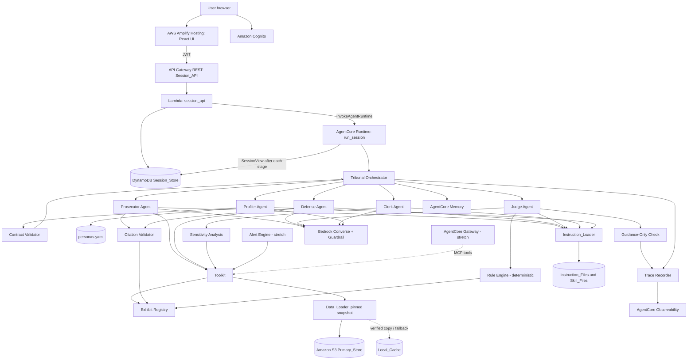
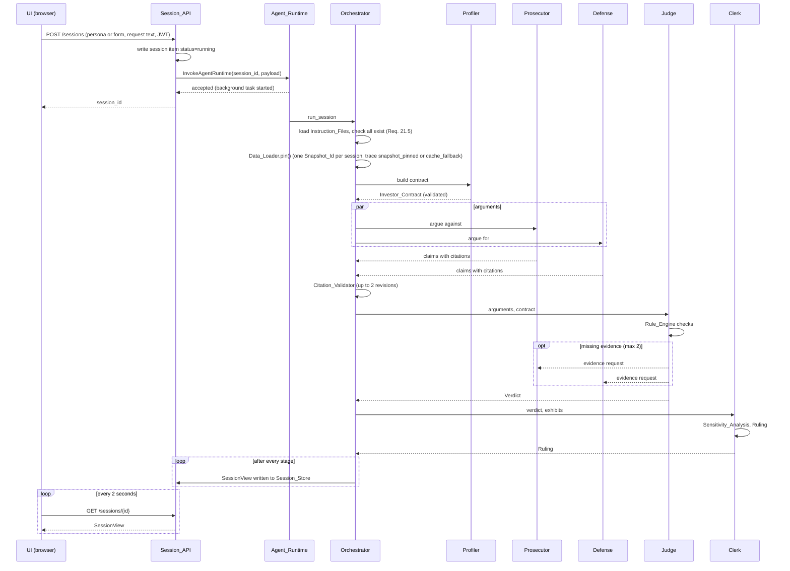
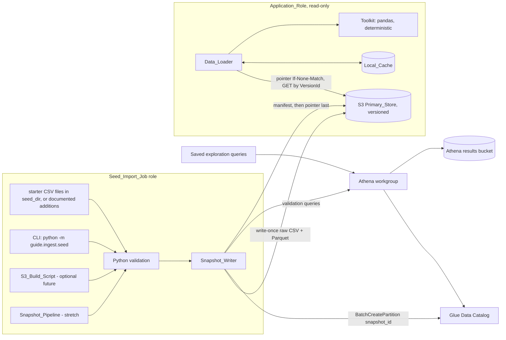

# Design Document

## Overview

The Agentic Investment Guide is a simulation-only multi-agent system. The MVP is the Decision Tribunal: five agents (Profiler, Prosecutor, Defense, Judge, Clerk) evaluate one Investment_Request against an Investor_Contract. The backend is Python 3.11 (boto3, pandas, pyarrow, `jsonschema`, `hypothesis`). The UI is a React and TypeScript single-page application hosted on AWS Amplify Hosting. A Session_API (API Gateway and Lambda) connects the UI to the Python core, which runs unchanged on Amazon Bedrock AgentCore Runtime.

The Guide_System is a guidance website. It only guides: it never places, routes, prefills, or triggers an order, transfer, or brokerage or bank action, and it holds no brokerage or bank credentials. The UI offers two modes over the same data: a Friendly_Mode (default) with a courtroom scene and short plain-language summaries, and an Advanced_Mode with full detail.

Eight design principles drive the structure:

1. **Numbers come only from code.** Deterministic Toolkit functions read the Dataset and emit immutable, numbered Exhibits. Agents cite Exhibits and never compute figures.
2. **Verdicts come from code.** The Judge's pass/fail per rule and the Verdict are computed deterministically. The language model only writes narrative.
3. **Citations are enforced.** A Citation_Validator rejects any claim without a valid Exhibit reference or whose numbers differ from the Exhibit.
4. **Agents are thin.** Prosecutor and Defense are two role prompts over one shared Toolkit and one Exhibit_Registry. The orchestrator is plain Python behind one entry point, `run_session`, which the Agent_Runtime, the tests, and a local command-line runner all call.
5. **Guidance only, enforced in four layers.** The Bedrock Guardrail, a deterministic Judge check, a static code and configuration scan in the test suite, and a UI without action controls each block the Guidance_Only_Rule independently. The Session_API has no action route. The system contains no brokerage or bank client and no credential fields.
6. **Personas are templates, not a closed list.** `personas.yaml` ships three Persona_Templates (Amira, Mateo, Robert) transcribed from `data/context.md`, with verbatim French excerpts and a `quoted` or `assumption` basis plus rationale for each shipped value. The user can edit, extend, duplicate, or replace them. The Profiler reads values from the file or the form deterministically and never asks the model for persona facts.
7. **One system of record, pinned snapshots.** Amazon S3 holds immutable Dataset_Snapshots (raw CSV, typed Parquet, manifest). A session pins one Snapshot_Id at start and every Exhibit names it. The Local_Cache only saves downloads and, when S3 is unreachable, serves a checksum-verified copy with a visible, traced fallback notice. Snapshots come only from the licensed starter files and documented additions. The team downloads no new Yahoo Finance data.
8. **AWS-native, MVP first.** Each AWS service has one clear role, least-privilege IAM, and a config key. Everything marked MVP in the AWS service map is deployed by one CDK command. Stretch services are optional and switched by CDK context flags.

The Flight Simulator (Requirement 12) and Alerts (Requirement 15) are optional extensions. They reuse the Toolkit with an `as_of` parameter and the same Tribunal pipeline. Each is described in a separate section and can be left out without affecting the MVP. The former Companion_Extension (Requirement 14) was removed from the scope.

### Hosting and runtime decision

AWS Amplify Hosting serves static and server-rendered JavaScript web apps (React, Next.js, and similar). It cannot run a long-lived Python server, so a Streamlit app cannot be hosted on it. Three options were compared.

| Option | Description | Python core | Effort | AWS services shown | Verdict |
| --- | --- | --- | --- | --- | --- |
| (a) Amplify Hosting SPA + Cognito + API | React SPA on Amplify Hosting, Cognito sign-in, API Gateway and Lambda, Python agents on AgentCore Runtime | Unchanged behind `run_session` and an API | Highest: new UI in TypeScript, API, session store | Amplify, Cognito, API Gateway, Lambda, DynamoDB, AgentCore Runtime | **Chosen for the MVP** |
| (b) Streamlit container | Streamlit in a container on App Runner or ECS Fargate behind CloudFront, Cognito in front | Unchanged, no API layer | Lowest: UI tasks stay Python | App Runner or Fargate, CloudFront, Cognito | Fallback |
| (c) Amplify Gen 2 | Amplify Gen 2 defines auth, data, and hosting in TypeScript, with a custom backend | Unchanged behind an API | High, and splits infrastructure across two tools | Amplify, Cognito, AppSync or API | Rejected |

Decision: option (a), under a hard gate. At Sunday 09:00 local time, IF option (a) has not completed one Tribunal_Session end to end on AWS, THEN the team switches to option (b) on App Runner, which reads the same `SessionView` and calls the same `run_session`, and stops work on option (a). The Session_API and the Session_Store remain usable by option (b).

- It keeps the Python core (agents, Toolkit, Judge, Clerk) unchanged: the SPA only renders one `SessionView` JSON document and calls three API operations.
- It follows the team's own Amplify suggestion and uses AWS services that jurors can see: Amplify, Cognito, API Gateway, DynamoDB, AgentCore Runtime.
- It separates the UI from the verifiable core, so the two modes read the same data by construction.
- Option (c) is rejected because Amplify Gen 2 backends are written in TypeScript, so the team would define Cognito and the API in a second infrastructure tool beside the CDK Python app for no gain.

Trade-off: the team writes a TypeScript front end and an API layer, and replaces the Streamlit AppTest tests with Vitest component tests and API contract tests. Tasks 11.x are reworked accordingly (none were started). Three mitigations keep the cost low: the front end is two views over one JSON document; the `SessionView` schema in the repository is the contract for both sides; and option (b) remains a fallback, because `run_session` and the SessionView do not change if the team has to fall back to a Python UI.

Why a Session_Store and polling: a Tribunal_Session takes tens of seconds. API Gateway REST integrations time out at 29 seconds by default, so the API cannot wait. `POST /sessions` returns a session identifier at once, the Agent_Runtime writes the SessionView to DynamoDB after each stage, and the UI polls `GET /sessions/{id}` every 2 seconds. A mode switch changes only `view.mode` in the browser and does not touch the session.

Why AgentCore Runtime and not Lambda for the orchestrator: a session can exceed the API time limits, the runtime gives per-session isolation and integrates with AgentCore Observability, and it is the intended host for agents. Risk: the runtime is newer than Lambda. Fallback: a `SessionRunner` Lambda (15-minute limit) calls the same `run_session`, behind the same API.

### AWS service map

Legend: MVP means deployed by `make deploy` and used in the demo. The Delivery Tiers of the requirements document override this table: an MVP row marked "lean" is built only in its Tier 2 form. Stretch means switched on by a CDK context flag and built only if time remains. Not adopted means evaluated and rejected for the reason given.

| Service | Role in the system | Requirement | Status |
| --- | --- | --- | --- |
| AWS Amplify Hosting | Hosts the React UI (manual zip deployment, no Git token) | 22.1 | MVP |
| Amazon Cognito (user pool, app client) | Sign-in and JWTs for the UI and the Session_API | 22.2 to 22.4 | MVP |
| Amazon API Gateway (REST) | Session_API with a Cognito authorizer | 22.3 to 22.11 | MVP |
| AWS Lambda | Session_API handlers (Python) | 22.5 to 22.9 | MVP |
| Amazon DynamoDB | Session_Store: SessionViews, Custom_Profiles, 7-day TTL; shared Precedent partition | 22.5 to 22.12, 31 | MVP |
| Amazon Bedrock AgentCore Runtime | Agent_Runtime for the orchestrator, agents, and Toolkit | 23.1 to 23.3 | MVP |
| Amazon ECR | Container image of the Agent_Runtime (CDK image asset) | 23.1 | MVP |
| Amazon Bedrock Converse API | Every agent call, with tool use | 2.8, 8.1 | MVP |
| Amazon Bedrock Guardrails | Challenge_Rules and Guidance_Only_Rule on every call | 5.7, 13.5 | MVP |
| AgentCore Memory | Contracts and summaries, keyed by user and profile | 8.4, 23.4 | MVP |
| AgentCore Observability (OpenTelemetry) | Spans for agent calls, tool calls, Judge checks | 8.3, 23.5 | MVP |
| Amazon S3 | Primary_Store: versioned, SSE-S3, deny-delete bucket policy; one pinned snapshot with checksums (Tier 2); conditional pointer, VersionId reads, and Cache_Fallback deferred (Tier 3); Athena results bucket | 17, 18 | MVP (lean) |
| AWS Glue Data Catalog | Explicit tables partitioned by `snapshot_id` | 18.4, 18.5 | MVP |
| Amazon Athena | Validation cross-checks and exploration, never an Exhibit read path | 19 | MVP |
| AWS IAM | One least-privilege role per component | 8.9 to 8.12, 25.1, 25.2 | MVP |
| Amazon CloudWatch | Log groups with 30-day retention and Bedrock model invocation logs (Tier 2); dashboard, alarms, and SNS topic deferred (Tier 3) | 25.3, 25.6 (25.4, 25.5 deferred) | MVP (lean) |
| Bedrock model invocation logging | Prompt and response audit log in CloudWatch | 25.6 | MVP |
| AWS X-Ray | Active tracing of the Session_API Lambdas | 25.8 | Stretch (Tier 3) |
| AWS Budgets | Monthly cost budget with 80 percent and forecast alerts | 25.7 | Stretch (Tier 3) |
| AWS CDK (Python) and CloudFormation | All resources, one-command deploy | 26 | MVP |
| AgentCore Gateway | Toolkit functions as MCP tools | 23.7, 23.8 | Stretch |
| AgentCore Identity | JWT inbound authorization on the Agent_Runtime | 23.9 | Stretch |
| AWS WAF | Managed rules and rate limit on the API stage and Amplify app | 25.9 | Stretch |
| AWS KMS customer managed key | Encryption of S3, DynamoDB, log groups | 25.10 | Stretch |
| AWS CloudTrail data events | Audit of S3 object access on the Primary_Store | 25.11 | Stretch |
| S3 Object Lock | Governance-mode retention of snapshot objects | 25.12 | Stretch |
| Amazon EventBridge and AWS Step Functions | Snapshot_Pipeline triggered by `incoming/*/_READY` | 24.1 to 24.4 | Stretch |
| AWS Glue ETL job | CSV to Parquet variant with a parity test against the Snapshot_Writer | 24.5, 24.6 | Stretch |
| Amazon Bedrock Knowledge Bases | Not adopted: the data is numeric tables read by a deterministic Toolkit, and vector retrieval would add nondeterminism and break the "numbers come only from code" principle | none | Not adopted |
| AWS Glue crawler | Not adopted: type inference could turn dates into strings; explicit tables and explicit partitions keep the catalog equal to the written snapshots | 24.7 | Not adopted |
| AWS Lake Formation | Not adopted: one account, one data owner, and IAM plus the bucket policy already express the permissions; Lake Formation would add a second permission model | none | Not adopted |
| AWS Secrets Manager | Not adopted: the system holds no secret; credentials come from the AWS credential chain and roles | 25.13 | Not adopted |

Demo-facing statement (5 minutes): (1) Cognito sign-in with the demo user and the Amplify-hosted UI, 15 s; (2) Robert "30% in TSLA" in Friendly_Mode: courtroom, one claim struck by the Citation_Validator, Verdict accept with conditions or reject with the computed maximum weight, then one Appeal (horizon 10 years) side by side, 90 s; (3) Amira with the same request: a different Verdict that cites Robert's Precedent, 40 s; (4) Mateo "10% in XOM": ESG exclusion with its source and the exclusion-cost Exhibit, 30 s; (5) the accepted diversification case, 15 s; (6) Advanced_Mode: one statement traced to its Exhibit, source file, and Snapshot_Id, then the AgentCore Observability view and one Guardrail block, 40 s; (7) data platform: S3 snapshot, Glue tables, one Athena validation query, 20 s; (8) the Benchmark slide from `docs/benchmark.md`, 20 s; closing, 20 s. Stretch services appear only if they are built.

### Technology choices

| Concern | Choice | Reason |
| --- | --- | --- |
| UI | React, TypeScript, Vite, Amplify Auth libraries; Vitest, React Testing Library, fast-check for tests | Hostable on Amplify Hosting (Req. 22.1) |
| API | API Gateway REST, Cognito authorizer, Python Lambda handlers | Req. 22.3 to 22.11 |
| Session state | DynamoDB on-demand table with TTL | Req. 22.5 to 22.12 |
| Agent hosting | Bedrock AgentCore Runtime, one container image | Req. 23.1 |
| LLM access | Amazon Bedrock Converse API with tool use | Req. 8.1, 2.8 |
| Safety | Bedrock Guardrails | Enforces Challenge_Rules (Req. 5.7) |
| Memory | AgentCore Memory | Stores contracts and summaries (Req. 8.4, 23.4) |
| Observability | AgentCore Observability (OpenTelemetry) plus local JSON trace | Req. 8.3, 9.4, 23.5 |
| Data store | Amazon S3 (versioned bucket) as system of record; local cache directory | Req. 8.5, 8.6, 17 |
| Table format | Parquet via `pyarrow`, partitioned by `snapshot_id`; raw CSV kept beside it | Req. 18.1 to 18.3 |
| Catalog | AWS Glue Data Catalog, explicit table definitions in CDK (no crawler) | Req. 18.4, 18.5 |
| SQL queries | Amazon Athena workgroup for validation cross-checks and exploration only | Req. 19 |
| Starter data | CSV files built by `data/build_dataset.py` (Baseline_Build_Script), unchanged; no download by the Guide_System | Req. 20 |
| In-memory compute | pandas over Parquet tables of the pinned snapshot | Req. 2, 3 |
| Persona definitions | `personas.yaml` loaded with PyYAML and checked against a light JSON schema | Req. 16 |
| Agent instructions | Markdown Instruction_Files and Skill_Files composed by the Instruction_Loader | Req. 21 |
| Infrastructure as code | AWS CDK v2 in Python | Req. 26 |
| AWS mocks in tests | `moto` for S3, Glue, and DynamoDB, `botocore.stub.Stubber` for Athena | Req. 10.10 to 10.15, 10.18 |
| Tests | pytest and hypothesis (backend), Vitest and fast-check (front end) | Req. 10, 13.8, 13.9 |

IaC decision: AWS CDK in Python, not hand-written CloudFormation. The team writes Python, CDK produces CloudFormation (so `cfn-lint` and template parsing still work), IAM statements are generated with least-privilege grant helpers, and one `cdk deploy --all` deploys everything. The synthesized templates are "the deployment templates" of Requirements 8.10 to 8.14 and 10.15.

## Architecture



### Session flow



### Data platform



```mermaid
sequenceDiagram
    participant J as Seed_Import_Job
    participant W as Snapshot_Writer
    participant S as S3
    participant G as Glue
    participant A as Athena
    J->>S: read pointer and current manifest (no fallback; abort if unreachable)
    J->>J: read CSV files from seed_dir, apply Universe_Additions_File rules
    J->>J: Python validation (no download of any kind)
    J->>W: draft: tables as raw CSV bytes + carried-over tables
    W->>S: PutObject IfNoneMatch="*" (raw CSV, Parquet)
    W->>G: BatchCreatePartition(snapshot_id) per table
    W->>A: validation queries (snapshot_id parameter)
    W->>S: PutObject manifest (write-once)
    W->>S: PutObject pointer IfMatch=<old ETag> (commit point)
```

The pointer update is the only commit point. A failure at any earlier step leaves the pointer unchanged (Req. 18.6, 19.3, 20.7). Objects of an uncommitted snapshot may remain in S3, but no pointer references them, and the Data_Loader reads only through the pointer.

### Module layout

```
guide/
  config.py            # region, model id, guardrail id, bucket/prefix, cache dir, S3 timeouts, Glue db, Athena workgroup, session table, runtime ARN, macro lags, sensitivity ranges
  data/loader.py       # SnapshotStore + PinnedSnapshot (S3 primary, cache-first reads, fallback); LocalSource kept for tests and seeding
  data/cache.py        # LocalCache: pointer + ETag, files keyed by (key, version_id), SHA-256 verification
  data/snapshot.py     # Snapshot_Id format, SnapshotManifest, SnapshotPointer, SnapshotInfo, JSON (de)serialization
  data/manifest.schema.json, data/pointer.schema.json
  data/parquet_io.py   # TABLE_SCHEMAS, csv_to_parquet, read_parquet
  data/catalog.py      # Glue partition registration
  data/quality.py      # CNQ note, survivorship text, unsupported-topic detection, snapshot and fallback notes
  athena/queries.py    # parameterized query builder, validation queries, runner
  athena/sql/*.sql     # saved exploration queries, one or more per table
  ingest/validate.py   # Python validation checks, universe restriction
  ingest/writer.py     # Snapshot_Writer
  ingest/seed.py       # Seed_Import_Job library and CLI: starter files and documented additions -> Dataset_Snapshot
  ingest/universe_additions.yaml  # documented extra tickers (empty by default)
  contract/personas.yaml
  contract/personas.schema.json
  contract/personas.py # tolerant Persona_File loader
  contract/schema.json
  contract/profiler.py
  contract/validate.py
  toolkit/exhibits.py  # Exhibit, ExhibitRegistry
  toolkit/metrics.py   # return, volatility, drawdown, correlation, portfolio
  toolkit/align.py     # FX conversion, calendar alignment, as_of filter, macro lag
  toolkit/tools.py     # Converse tool specs
  agents/base.py       # Bedrock client wrapper, retry, guardrail, System_Prompt and Instruction_Hash
  agents/instructions.py        # Instruction_Loader
  agents/instructions/*.md      # one Instruction_File per agent
  agents/skills/*.md            # shared Skill_Files
  agents/prosecutor.py, defense.py, judge.py, clerk.py
  tribunal/orchestrator.py
  tribunal/entrypoint.py        # run_session: the single entry point used by runtime, tests, and CLI
  tribunal/session_view.py      # SessionView model, JSON (de)serialization
  tribunal/session_view.schema.json
  tribunal/citations.py
  tribunal/rules.py
  tribunal/sensitivity.py
  tribunal/request_parser.py
  tribunal/guidance_only.py  # Judge-side Guidance_Only_Rule check and statement removal
  tribunal/summaries.py      # plain-language summaries, at most 60 words
  session/store.py     # SessionStore: DynamoDB implementation and in-memory implementation
  api/handler.py       # Session_API Lambda handlers
  runtime/app.py       # AgentCore Runtime entry point (background task around run_session)
  runtime/Dockerfile
  trace/recorder.py
  flight/             # optional stretch
  alerts/engine.py    # optional stretch: Market_Event detection and Alerts
  gateway/            # optional stretch: Toolkit as MCP tools for AgentCore Gateway
  pipeline/           # optional stretch: Snapshot_Pipeline handlers and Glue ETL job
data/
  build_dataset.py     # Baseline_Build_Script: existing, unchanged, never run by the Guide_System
  build_dataset_s3.py  # S3_Build_Script: optional future wrapper around guide/ingest/seed.py
frontend/
  package.json, vite.config.ts, tsconfig.json
  src/api/client.ts            # Session_API client, JWT from Amplify Auth
  src/model/sessionView.ts     # types generated from session_view.schema.json, view store, selectors
  src/friendly/                # courtroom scene, summaries, verdict
  src/advanced/                # exhibits, rule table, sensitivity, trace, JSON download
  src/App.tsx                  # auth gate, persona picker, form, request box, mode switch, banners
  src/__tests__/
infra/
  app.py, cdk.json     # CDK_App entry and context flags
  stacks/              # data_stack, auth_stack, api_stack, runtime_stack, frontend_stack, ops_stack, guardrail_stack, optional stretch stacks
Makefile               # deploy, seed, destroy
tests/
  test_guidance_scan.py  # static scan of source and configuration
  test_personas.py       # Persona_File vs context.md (Req. 10.9)
  fixtures/context_persona_facts.yaml  # facts transcribed by hand from context.md section 3
```

## Components and Interfaces

### Config (Req. 8.7, 3.5)

Loaded from environment variables and `config.yaml`. Contains `aws_region`, `model_id`, `guardrail_id`, `guardrail_version`, `macro_publication_lag_days` (series_id to days), the data settings, and the deployment settings below. No credential fields exist. A log filter redacts values matching AWS key patterns.

| Key | Example | Use |
| --- | --- | --- |
| `s3_bucket`, `s3_prefix` | `alphaforge-guide-data`, `dataset` | Primary_Store location (required) |
| `cache_dir` | `/workshop/Agent52/.cache/dataset` | Local_Cache root (git-ignored) |
| `s3_connect_timeout_seconds`, `s3_read_timeout_seconds`, `s3_max_attempts` | 3, 10, 3 | Unreachable classification (Req. 17.8) |
| `glue_database` | `alphaforge_guide` | Data_Catalog |
| `athena_workgroup`, `athena_results_uri`, `athena_bytes_scanned_cutoff` | `alphaforge-guide`, `s3://alphaforge-guide-athena-results/results/`, 104857600 | Req. 19.1 |
| `seed_dir` | `/workshop/Agent52/data` | Seed_Import_Job input only (Req. 18.8, 27.1) |
| `persona_file` | `guide/contract/personas.yaml` | Req. 16 |
| `instruction_dir` | `guide/agents` | Instruction_Files and Skill_Files (Req. 21) |
| `sensitivity_ranges` | `{position_size: [0.0, 0.5, 0.01], horizon_years: [1, 20, 1]}` | Req. 6.6 |
| `speculative_volatility_threshold` | 0.50 | Speculative-asset rule |
| `trace_summary_max_chars` | 400 | Req. 9.6 |
| `session_table` | `alphaforge-guide-sessions` | Session_Store (Req. 22.5) |
| `agent_runtime_arn` | set by the CDK_App output | Session_API invokes the Agent_Runtime (Req. 23.2) |
| `agentcore_memory_id` | set by the CDK_App output | AgentCore Memory (Req. 23.4) |
| `cors_origin` | the Amplify app URL | Req. 22.11 |

The old `data_location` (`local` or `s3`) and `data_dir` keys are removed: S3 is always the source and the local directory is only a cache (Req. 8.5, 8.6). `load_config` rejects `data_location` with an error that points to `cache_dir`, so a stale config cannot silently switch the system to local reads.

### Data layer (Req. 8.5, 8.6, 17, 18, 19, 20)

#### S3 layout

```
s3://{s3_bucket}/{s3_prefix}/
  pointers/current.json                                   # Current_Snapshot_Pointer (mutable, versioned)
  snapshots/{snapshot_id}/raw/{table}.csv                 # source CSV, unchanged (write-once)
  snapshots/{snapshot_id}/manifest.json                   # Snapshot_Manifest (write-once)
  curated/{table}/snapshot_id={snapshot_id}/part-0000.parquet   # Glue partition location (write-once)
s3://{athena results bucket}/results/                     # Athena query results only
```

Partitioning is by `snapshot_id` only. The whole Dataset is about 50,000 rows (under 5 MB as Parquet), so a ticker or date partition would only create many small files. Bucket versioning is on, and the manifest records each object's `VersionId`, so a read by version returns the exact bytes even if a key were overwritten. The bucket policy denies `s3:DeleteObject` and `s3:DeleteObjectVersion` on `snapshots/` and `curated/` (Req. 8.13). The writer uses `PutObject` with `IfNoneMatch="*"` so snapshot objects are write-once (Req. 18.10).

Snapshot_Id format: `^\d{8}T\d{6}Z-[a-z0-9]{1,32}$`, the UTC retrieval timestamp plus a source label. The baseline is `20261113T000000Z-starter`.

#### Snapshot models (`data/snapshot.py`)

```python
SNAPSHOT_ID_RE = re.compile(r"^\d{8}T\d{6}Z-[a-z0-9]{1,32}$")

@dataclass(frozen=True)
class FileEntry:
    table: str                       # assets_universe | prices_daily | corporate_actions | fx_usdcad_daily | macro_rates
    kind: Literal["raw_csv", "parquet"]
    key: str
    version_id: str
    sha256: str
    rows: int

@dataclass(frozen=True)
class SnapshotManifest:
    schema_version: int              # 1
    snapshot_id: str
    source: Literal["starter", "addition"]
    retrieved_at: datetime           # UTC
    library_versions: Mapping[str, str]   # {"pandas": "...", "pyarrow": "..."}
    coverage_start: date
    coverage_end: date
    tickers: tuple[str, ...]
    files: tuple[FileEntry, ...]
    carried_over: Mapping[str, str]  # table -> source Snapshot_Id (Req. 20.9)
    validation: Mapping              # {"python": {...}, "athena": {...} | "skipped"}

@dataclass(frozen=True)
class SnapshotPointer:
    snapshot_id: str
    updated_at: datetime

@dataclass(frozen=True)
class SnapshotInfo:                  # what a session pins and every Exhibit names
    snapshot_id: str
    source: str
    retrieved_at: datetime
    coverage_end: date
    served_from: Literal["primary", "cache", "cache_fallback"]
    fallback_cause: str | None

def manifest_to_json(m: SnapshotManifest) -> str      # sorted keys, ISO dates
def manifest_from_json(s: str) -> SnapshotManifest    # validates against manifest.schema.json; raises ManifestError(fields)
def pointer_to_json(p) -> str; def pointer_from_json(s) -> SnapshotPointer
```

`served_from="cache"` means the Primary_Store was reachable and the cached bytes were verified, which is an efficiency path and needs no notice. Only `cache_fallback` triggers the notice and notes.

#### Data_Loader (`data/loader.py`, `data/cache.py`)

```python
class DataSource(Protocol):
    snapshot: SnapshotInfo
    def read_table(self, table: str) -> pd.DataFrame: ...

class SnapshotStore:
    def __init__(self, config: Config, s3_client=None, cache: LocalCache | None = None): ...
    def pin(self) -> "PinnedSnapshot"          # resolve pointer once (Req. 17.2)

class PinnedSnapshot:                          # implements DataSource
    snapshot: SnapshotInfo
    manifest: SnapshotManifest
    def read_table(self, table: str) -> pd.DataFrame   # Parquet of this snapshot only (Req. 17.3, 18.9)

class LocalCache:
    def __init__(self, root: Path): ...
    def get_pointer(self) -> tuple[SnapshotPointer, str] | None        # (pointer, etag)
    def put_pointer(self, pointer: SnapshotPointer, etag: str) -> None
    def get_manifest(self, snapshot_id: str) -> SnapshotManifest | None
    def put_manifest(self, m: SnapshotManifest) -> None
    def get_verified(self, entry: FileEntry) -> bytes | None           # None if absent or SHA-256 differs
    def put_file(self, entry: FileEntry, data: bytes) -> None          # path: {root}/objects/{sha256}

class LocalSource:                             # kept from task 1.1: reads CSVs from a directory
    def read_csv(self, name: str) -> pd.DataFrame   # used by tests and by the seed operation only

def classify_s3_error(exc: Exception) -> Literal["unreachable", "denied", "other"]
```

`pin()` works as follows:

1. GET `pointers/current.json` with `IfNoneMatch=<cached ETag>`. A 304 keeps the cached pointer; a 200 replaces it (Req. 17.5). The pointer is the only mutable object, so it is the only object that can go stale. It is checked once per session, which keeps all of a session's reads consistent.
2. Load the manifest (cache first, verified against its own `VersionId`; otherwise GET by `VersionId`). Validate it against `manifest.schema.json` (Req. 17.14, 17.16).
3. Record `snapshot_pinned` in the Trace (Req. 9.7).

`read_table(table)` takes the Parquet `FileEntry` from the manifest, returns cached bytes when `get_verified` matches the manifest SHA-256 (Req. 17.4), and otherwise downloads with `GetObject(Key, VersionId)`. It verifies the SHA-256 and stores the bytes in the cache. A mismatch discards the file and retries once, then raises `DataIntegrityError(file)` (Req. 17.6, 17.7). Snapshot objects are immutable and fetched by version, so a cached file whose version id and checksum match can never be stale.

`classify_s3_error` maps `EndpointConnectionError`, `ConnectTimeoutError`, `ReadTimeoutError`, `NoCredentialsError`, and `ClientError` with HTTP 5xx after `s3_max_attempts` to `unreachable`. It maps `AccessDenied`, `403`, and `InvalidAccessKeyId` to `denied`. On `unreachable`, `pin()` uses the cached pointer and manifest and verifies every cached Parquet file of that snapshot up front. If they verify, it returns a `PinnedSnapshot` with `served_from="cache_fallback"` and the cause, and records a `cache_fallback` Trace event (Req. 17.8, 17.10). If the cache holds no verified snapshot, it raises `DatasetUnavailable(location)` (Req. 17.13). On `denied`, it raises `DataConfigError(resource)` without fallback, so IAM mistakes are not hidden behind cached data (Req. 17.9).

The Local_Cache can be pre-filled by the seed operation for the baseline snapshot, which lets a laptop without network still run the demo. That run is a Cache_Fallback and shows the notice.

#### Parquet conversion (`data/parquet_io.py`)

```python
TABLE_SCHEMAS: dict[str, pa.Schema] = {
    "assets_universe":   asset_id string, ticker string, name string, asset_class string, market string, currency string, sector string
    "prices_daily":      date date32, ticker string, open double, high double, low double, close double, adj_close double, volume int64, currency string
    "corporate_actions": ex_date date32, ticker string, action string, value double, unit string
    "fx_usdcad_daily":   date date32, usdcad double, cadusd double
    "macro_rates":       date date32, series_id string, value double, unit string, frequency string, label string, source string
}
def read_csv_typed(table: str, data: bytes) -> pd.DataFrame     # declared dtypes, ISO date parsing
def csv_to_parquet(table: str, data: bytes) -> bytes           # pyarrow, snappy, deterministic (no write timestamp in metadata)
def read_parquet(table: str, data: bytes) -> pd.DataFrame
```

Rows keep their CSV order. `csv_to_parquet` fails on a missing or extra column. The Glue table columns are generated from the same `TABLE_SCHEMAS` so the catalog and the code cannot drift (Req. 18.2, 18.4).

#### Glue Data Catalog (`deploy/data_platform.yaml`, `data/catalog.py`)

One `AWS::Glue::Database` (`alphaforge_guide`) and five `AWS::Glue::Table` resources with explicit columns, `PartitionKeys: [{Name: snapshot_id, Type: string}]`, Parquet SerDe, and `Location: s3://{bucket}/{prefix}/curated/{table}/`. `register_partitions(glue, database, snapshot_id)` calls `BatchCreatePartition` for the five tables and treats `AlreadyExistsException` as success, so retries are idempotent.

Explicit table definitions are used instead of a crawler. A crawler would infer types (dates may become strings, `volume` may become double), could change the schema when data changes, and needs its own role and schedule. Partition projection was also rejected because the requirement is that each validated snapshot is registered explicitly, which makes the list of partitions equal to the list of written snapshots.

#### Athena (`athena/queries.py`, `athena/sql/`)

Decision: Athena is used for **validation cross-checks and exploration**, and is **not** a read path for the Toolkit (Req. 19.8). Reasons:

- The Toolkit must run during a Cache_Fallback. Athena needs S3 and network, so a Toolkit read path through Athena would have no offline fallback.
- A Tribunal_Session makes dozens of tool calls. Each Athena query takes about 1 to 3 seconds to start and bills at least 10 MB scanned, while the whole Dataset fits in memory in under a second.
- Exhibit values must come from one tested Python implementation. Computing metrics in SQL would duplicate the logic and the place where look-ahead rules are enforced.
- Reproducibility holds in both cases because every query is filtered by `snapshot_id`, but the Python path has fewer moving parts.

Athena still shows the data as standard tables for the AWS criterion and for jurors. The Snapshot_Writer runs validation queries (Req. 19.2), saved queries under `athena/sql/` support exploration (Req. 19.5), and an integration test checks row-count parity with the Data_Loader (Req. 10.14).

```python
@dataclass(frozen=True)
class AthenaQuery:
    name: str
    sql: str                       # contains "WHERE snapshot_id = ?"
    parameters: tuple[str, ...]    # ("'20261113T000000Z-starter'",)

def build_query(name: str, snapshot_id: str) -> AthenaQuery     # raises InvalidSnapshotId unless SNAPSHOT_ID_RE matches (Req. 19.7)
def validation_queries(snapshot_id: str) -> list[AthenaQuery]  # row counts, duplicates, ticker set, adj_close <= 0, currency mismatch
def run_query(client, q: AthenaQuery, workgroup: str, timeout_s: int = 60) -> pd.DataFrame
```

Queries use `StartQueryExecution(ExecutionParameters=...)`, so the Snapshot_Id is never concatenated into SQL. It is validated by regex first, then passed as a quoted string literal. The workgroup sets `EnforceWorkGroupConfiguration: true`, `ResultConfiguration.OutputLocation` in the results bucket with SSE-S3, and `BytesScannedCutoffPerQuery` (Req. 19.1). The results bucket expires objects after 7 days.

#### Snapshot_Writer (`ingest/writer.py`)

```python
@dataclass(frozen=True)
class SnapshotDraft:
    snapshot_id: str
    source: Literal["starter", "addition"]
    retrieved_at: datetime
    tables: Mapping[str, bytes]        # table -> raw CSV bytes
    carried_over: Mapping[str, str]
    library_versions: Mapping[str, str]

@dataclass(frozen=True)
class WriteResult:
    status: Literal["committed", "rejected", "failed"]
    snapshot_id: str
    failed_step: str | None            # "python_validation" | "write" | "glue" | "athena_validation" | "manifest" | "pointer"
    violations: tuple[str, ...]

def write_snapshot(draft, s3, glue, athena, config, expected_pointer_etag: str | None) -> WriteResult
```

Order: Python validation (`ingest/validate.py`) → write raw CSV and Parquet with `IfNoneMatch="*"` and collect `VersionId` and SHA-256 → Glue partitions → Athena validation (a result different from Python's rejects; unavailable is recorded as `skipped`) → manifest (write-once) → pointer with `IfMatch=<expected ETag>` (Req. 18.5, 18.6, 19.2 to 19.4). A concurrent ingestion that already moved the pointer makes the conditional write fail with `PreconditionFailed`, and the result is `failed` at step `pointer`.

#### Seed_Import_Job (`ingest/seed.py`) and the build scripts (Req. 18.8, 20, 27)

There is one import concept: the Seed_Import_Job. Its library is `guide/ingest/seed.py`. It builds a `SnapshotDraft` from CSV files and calls the Snapshot_Writer. It never downloads data.

```python
@dataclass(frozen=True)
class SeedResult:
    status: Literal["committed", "rejected", "failed", "exists", "dry_run"]
    snapshot_id: str
    in_use_snapshot_id: str            # pointer after the run
    failed_step: str | None
    violations: tuple[str, ...]
    planned_keys: tuple[str, ...]      # filled for dry_run

def seed_snapshot(config, s3, glue, athena, input_dir: Path, label: str, retrieved_at: datetime,
                  additions: UniverseAdditions | None = None, dry_run: bool = False,
                  prefill_cache: bool = False) -> SeedResult
```

Steps:

1. Read the five CSV files from `input_dir` (default `seed_dir`). The baseline run uses `/workshop/Agent52/data`, label `starter`, and the retrieval date from `sources_metadata.csv` (2026-11-13), so the Snapshot_Id is `20261113T000000Z-starter` (Req. 18.8).
2. Apply the universe rule (Req. 20.8): tickers outside the starter `assets_universe` are accepted only when `ingest/universe_additions.yaml` lists them with name, asset class, market, currency, sector, source name, and data file, and `docs/data_sources.md` has an entry with the terms-of-use URL and a permitted-use statement (Req. 20.2, 20.3). Rejected tickers are named.
3. Carry over unchanged tables from the previous snapshot and record `carried_over` (Req. 20.9).
4. Python validation (Req. 20.6): no duplicate (date, ticker), every universe ticker has rows, currency per ticker equals the universe, `adj_close > 0`. A violation gives `rejected`, writes nothing, and keeps the pointer (Req. 20.7).
5. If the Snapshot_Id already exists in the Primary_Store, return `exists` and write nothing (Req. 18.10, 27.9).
6. `write_snapshot`. With `dry_run`, stop after step 5 and return `planned_keys` (Req. 27.7). With `prefill_cache`, copy the pointer, manifest, and Parquet objects into the Local_Cache after the commit (Req. 27.10).

Callers: `python -m guide.ingest.seed` (the MVP, used by `make seed`), the S3_Build_Script (optional future), and the Snapshot_Pipeline Lambda (stretch). Credentials come from the Seed_Import_Job role or an AWS profile. The Application_Role cannot write to S3 (Req. 8.10).

**Baseline_Build_Script (`data/build_dataset.py`).** The existing script that built the starter files locally: yfinance for prices and corporate actions, the Bank of Canada for FX, and the Bank of Canada and FRED for macro series. It stays unchanged as the reference for how the data was built. The Guide_System never runs it (Req. 20.11). The Data_Source_Document names it as the origin of the starter files (Req. 20.4).

**S3_Build_Script (`data/build_dataset_s3.py`, optional future improvement).** A thin command-line wrapper around `seed_snapshot`. It is not part of the MVP and is ready to implement once the S3-first storage tasks are done.

| Option | Meaning | Req. |
| --- | --- | --- |
| `--input-dir PATH` | Directory with the five CSV files; default `seed_dir`; may be the output directory of the Baseline_Build_Script | 27.1, 27.2 |
| `--label TEXT` | Source label of the Snapshot_Id; must match the Snapshot_Id format | 27.6 |
| `--retrieved-at ISO` | Retrieval timestamp when `sources_metadata.csv` is absent from the input directory | 27.6 |
| `--dry-run` | Validate and print the planned Snapshot_Id and object keys; write nothing | 27.7 |
| `--prefill-cache` | Copy the committed snapshot into the Local_Cache | 27.10 |

The script has no option that downloads anything, does not import `build_dataset.py`, and imports no `yfinance` (Req. 27.4, 27.5). Decision: the wrapper calls the library instead of becoming the job itself, so the Snapshot_Pipeline Lambda and the CLI share one tested code path and there is one Seed_Import_Job concept. Because the licensing decision stands, a rebuild always starts from the provided CSV files. Parquet output is deterministic (Req. 18.3), so two runs on identical input produce identical checksums (Req. 27.8).

Look-ahead note: `adj_close` is back-adjusted from the retrieval date of the starter data, so its price levels on old dates include dividends paid later. A dividend after the As_Of_Date scales all earlier prices by the same factor, so returns, volatility, drawdowns, and correlations computed from ratios inside the window are unchanged. The Toolkit therefore uses `adj_close` only through ratios. The As_Of_Date filter (Req. 3.6) and the coverage-end clamp (Req. 20.10) apply to every snapshot.

### Contract and Profiler (Req. 1)

```python
class Provenance(str, Enum):
    PERSONA_QUOTED = "persona_quoted"; PERSONA_ASSUMPTION = "persona_assumption"
    USER = "user"; FORM = "form"; DEFAULT = "default"

class InvestorContract(TypedDict):
    risk_level: Literal["low", "low_to_moderate", "moderate", "high"]
    horizon_years: float
    max_volatility: float          # annualized, fraction
    max_drawdown: float            # fraction, positive
    per_asset_cap: float
    per_asset_class_caps: dict[str, float]
    crypto_cap: float
    sector_caps: dict[str, float]
    esg_exclusions: list[str]
    speculative_limit: float | None
    provenance: dict[str, Provenance]

def build_contract_from_persona(persona: Persona) -> InvestorContract          # unedited template, no model call
def build_contract_from_form(values: dict, base: Persona | None = None) -> InvestorContract
def validate_contract_for_persona(c: dict, persona_id: str) -> list[FieldError]  # shipped-template limits of 1.6 to 1.8, unedited only
def validate_contract(c: dict) -> list[FieldError]   # empty list means valid
```

`build_contract_from_persona` copies each Contract_Value from a Persona entry into the contract and sets provenance from its basis (`quoted` gives `persona_quoted`, `assumption` gives `persona_assumption`, `user` gives `user`). It makes no Bedrock call (Req. 16.11, 16.15). `build_contract_from_form(values, base)` builds the contract from submitted form values. With a `base` Persona (the form was pre-filled from a template), each field whose value differs from the template gets provenance `user`, and each unchanged field keeps the template provenance (Req. 16.13). Without a `base` (blank form), only form values and stated defaults are used, with provenance `form` or `default`, and the Persona_File is never read (Req. 16.14). Persona-specific limits (Requirements 1.6 to 1.8) are checked only on the unedited shipped templates (`validate_contract_for_persona`); any edited contract is validated only against the generic schema (Req. 1.11). The Profiler uses the model only to map free text into form values, and never for persona facts (Req. 16.15). Schema validation is `jsonschema` against `schema.json`. The `risk_level` enum has `low`, `low_to_moderate`, `moderate`, `high`. A range horizon keeps the range and sets `horizon_years` to its lower bound (Req. 1.10). The `provenance` enum has the five values above.

A Custom_Profile is the saved form: `{profile_id, owner, base_persona_id | null, values}`. It lives in the Session_Store, is listed in the persona picker beside the Persona_Templates (Req. 7.1, 7.23), and is copied to AgentCore Memory keyed by user and profile identifier when Memory is enabled (Req. 23.4).

#### Persona_File (`contract/personas.yaml`, `contract/personas.py`) (Req. 16)

The file ships three Persona_Templates (`amira`, `mateo`, `robert`) as default starting points. The loader is tolerant: it accepts any number of entries, any ids, and edited values, as long as each entry satisfies a light schema.

```python
REQUIRED_FIELDS = ("id", "display_name", "risk_level", "horizon", "contract_values")
REQUIRED_CONTRACT_VALUES = ("horizon_years", "max_volatility", "max_drawdown", "per_asset_cap",
                            "per_asset_class_caps", "sector_caps", "crypto_cap", "esg_exclusions")
OPTIONAL_FACTS = ("age", "occupation", "family_situation", "experience", "objective",
                  "preferences_constraints", "persona_tests")
OPTIONAL_CONTRACT_VALUES = ("speculative_limit",)

@dataclass(frozen=True)
class PersonaFact:
    value: Any
    excerpt: str | None               # verbatim French text from context.md section 3 (shipped entries)

@dataclass(frozen=True)
class ContractValue:
    value: Any
    basis: Literal["quoted", "assumption", "user"] | None
    rationale: str | None
    excerpt: str | None

@dataclass(frozen=True)
class Persona:
    id: str
    display_name: str
    risk_level: str
    horizon: Any                      # single value or {min, max}
    facts: Mapping[str, PersonaFact]
    contract_values: Mapping[str, ContractValue]

@dataclass(frozen=True)
class PersonaLoadResult:
    personas: Mapping[str, Persona]                     # every valid entry, in file order
    field_errors: tuple[tuple[str, str], ...]           # (persona id or "entry <n>", field)

class PersonaFileError(Exception):                      # file missing, unreadable, or not parsable YAML
    reason: str

def load_personas(path: Path) -> PersonaLoadResult      # raises PersonaFileError only for an unreadable file
```

`load_personas` validates each entry against `personas.schema.json` (required fields, value types, fractions between 0 and 1, positive horizon, basis enum). A duplicate id is reported as `(id, "id")` and the later entry is excluded. An entry with a missing field or an invalid value is excluded and reported as `(persona id, field)`; every other entry stays available (Req. 16.2, 16.3, 16.5). When the file cannot be read or parsed, the loader raises `PersonaFileError`; the UI displays the message, lists no Persona_Template, and keeps the custom-profile form (Req. 16.6). Basis, rationale, and excerpt are optional for user-added entries and are required only for the shipped file. That requirement is enforced by `tests/test_personas.py` and not by the loader, so users can edit and extend the file freely (Req. 16.7, 16.8).

Horizon rule: `horizon_years` is the lower bound of the quoted range (Amira 15, Mateo 8, Robert 3). Its basis is `quoted`, and the rationale states the lower-bound rule. The lower bound is the conservative choice for drawdown tolerance. The user can enter another single value or a range in the form (Req. 16.10).

Proposed Contract_Values (team assumptions unless marked quoted; to be confirmed by the team):

| Value | Amira | Mateo | Robert | Basis and rationale |
| --- | --- | --- | --- | --- |
| risk_level | high | moderate | low_to_moderate | quoted ("Risque : élevé" / "modéré" / "faible à modéré") |
| horizon_years | 15 | 8 | 3 | quoted range, lower bound |
| max_volatility | 0.35 | 0.18 | 0.12 | assumption: annualized, scaled to risk level |
| max_drawdown | 0.40 | 0.25 | 0.15 | assumption: Robert retires within 3 to 5 years ("préserver le capital") |
| per_asset_cap | 0.15 | 0.10 | 0.10 | assumption: diversification ("une certaine diversification" for Amira) |
| per_asset_class_caps | crypto 0.15 | crypto 0.05 | crypto 0.02 | assumption; Amira "intéressée par les cryptoactifs" but "risque élevé" ≠ "tout est acceptable" |
| sector_caps | Information Technology 0.40 | Information Technology 0.35 | Information Technology 0.25 | assumption; Amira "éviter de miser exclusivement sur la tech" |
| crypto_cap | 0.15 | 0.05 | 0.02 | assumption; Robert "peu intéressé par les cryptos", lowest of the three (Req. 1.8) |
| esg_exclusions | [] | ["significant environmental controversies", "significant social controversies"] | [] | Mateo quoted ("éviter les entreprises liées à d'importantes controverses environnementales ou sociales") |
| speculative_limit | null | 0.10 | 0.05 | assumption; Mateo "peu intéressé par le hautement spéculatif" |

Speculative assets for the speculative-limit rule are crypto assets plus any asset whose Toolkit annualized volatility over the evaluation period exceeds `speculative_volatility_threshold`. This makes the rule deterministic and Exhibit-backed. The ESG exclusion rule stays `unverified` because the Dataset has no ESG scores (Req. 3.9).

### Exhibits and Registry (Req. 2.2, 2.3)

```python
@dataclass(frozen=True)
class Exhibit:
    number: int
    metric: str
    value: float | dict          # JSON-serializable, stored read-only
    period_start: date
    period_end: date
    assets: tuple[str, ...]
    currency: str
    source_files: tuple[str, ...]
    processing_notes: tuple[str, ...]
    inputs: Mapping                # arguments used, for determinism checks
    snapshot_id: str               # added by follow-up task 3.7 (Req. 2.2)
    snapshot_retrieved_at: str     # ISO 8601 UTC

class ExhibitRegistry:
    def __init__(self, snapshot: SnapshotInfo | None = None)   # snapshot bound once per session
    def add(self, **fields) -> Exhibit     # assigns next sequential number, fills snapshot fields
    def get(self, number: int) -> Exhibit | None
    def all(self) -> list[Exhibit]
```

The dataclass is frozen and uses tuples and a read-only mapping, so mutation raises an error. The registry is created with the session's pinned `SnapshotInfo`. It fills `snapshot_id` and `snapshot_retrieved_at`, and when `served_from == "cache_fallback"` it appends the fallback note from `quality.fallback_note(snapshot)` to every Exhibit (Req. 17.11). Toolkit functions cannot forget the note because it is added in one place. `source_files` entries name the table and snapshot (`prices_daily@20261113T000000Z-starter`), so the Trace link chain resolves to an exact S3 object version through the manifest (Req. 9.5).

### Toolkit (Req. 2, 3)

All functions take `registry`, `as_of: date | None`, and return `Exhibit | ToolError`. A `ToolError` never touches the registry.

```python
annualized_return(registry, ticker, start, end, as_of=None, display_ccy="CAD")
annualized_volatility(registry, ticker, start, end, as_of=None, display_ccy="CAD")
max_drawdown(registry, ticker, start, end, as_of=None, display_ccy="CAD")  # value, peak_date, trough_date
correlation(registry, ticker_a, ticker_b, start, end, as_of=None, display_ccy="CAD")
drawdown_in_period(registry, ticker, period_name_or_range, as_of=None)
portfolio_metrics(registry, weights: dict[str, float], start, end, as_of=None)
```

Shared pipeline, in order:

1. Validate tickers against the `assets_universe` table of the pinned snapshot; unknown ticker gives `ToolError(UNKNOWN_TICKER, ticker)`.
2. Filter observations to `date <= min(as_of, coverage_end)` (prices, FX, macro). When `as_of` is after the snapshot's `coverage_end`, add the note "data available up to {coverage_end} in snapshot {id}" (Req. 3.6, 20.10).
3. Convert USD-listed prices to CAD with `usdcad`; for missing FX dates carry the last earlier rate. Dates with no earlier FX rate at all are dropped and listed in the notes (Req. 3.12). Record each action in notes.
4. Align assets on the intersection of dates. Record the method and count in notes.
5. If any asset has fewer than 20 observations, return `ToolError(INSUFFICIENT_DATA)`.
6. Compute from `adj_close` daily simple returns.
7. If `CNQ.TO` is involved and the period includes 2022-08-22, append the split-anomaly note.
8. Register and return the Exhibit.

Macro series access (`macro_value(series_id, as_of)`) returns the latest value whose reference date plus the configured lag is on or before `as_of`.

Each function has a Converse tool spec (`toolSpec` with `inputSchema.json`) generated from its signature in `tools.py`. The tool runner dispatches a `toolUse` block, calls the function, and returns the Exhibit number and value in `toolResult`.

### Citation Validator (Req. 4.3 to 4.6)

```python
@dataclass
class Claim:
    text: str
    citations: list[int]
    numbers: list[NumberRef]   # (value, exhibit_number, field)

def validate_claim(claim, registry, tol=1e-4) -> list[CitationIssue]
def enforce(agent, claims, registry, max_revisions=2) -> tuple[list[Claim], list[TraceEvent]]
```

Agents return claims as structured JSON (`text`, `citations`, `numbers`). `validate_claim` fails when `citations` is empty, a number is absent from the registry, or a stated number differs from the Exhibit value beyond rounding tolerance. `enforce` returns failing claims to the agent up to 2 times, then drops them and records the removal.

### Rule Engine and Judge (Req. 5)

```python
@dataclass
class RuleResult:
    rule: str
    status: Literal["pass", "fail", "unverified"]
    observed: float | None
    limit: float | None
    exhibits: list[int]

def evaluate_rules(contract, request, registry) -> list[RuleResult]
def decide(results, contract, request, registry) -> Verdict
```

Rules checked: per-asset cap, per-asset-class cap, crypto cap, sector cap, maximum volatility (portfolio), maximum drawdown, ESG exclusion (unverified when scores are absent), speculative limit. `decide` works as follows:

- All rules pass: `accept`.
- Some fail: compute the largest position size at which every failed rule passes (bisection over position size using `portfolio_metrics`). If that size is greater than 0, return `accept_with_conditions` with a numeric maximum position. Otherwise return `reject`.
- Rules with no evidence produce an evidence request to Prosecutor or Defense, at most twice per session. Rules still lacking evidence are listed as `unverified`.
- If the Persona risk level is low to moderate and the request exceeds the per-asset cap, the Verdict records a tension statement.

The Judge Agent receives the computed results and writes only the narrative.

#### Guidance-only check (Req. 5.11, 5.12, 13)

```python
@dataclass
class GuidanceFinding:
    agent: str
    statement: str
    passed: bool
    matched_pattern: str | None

def check_guidance_only(agent: str, statements: list[str]) -> list[GuidanceFinding]
def strip_violations(ruling, findings) -> tuple[Ruling, list[TraceEvent]]
```

`check_guidance_only` is deterministic. It matches each statement against a pattern list covering imperative order or transfer instructions ("place the order", "transfer funds", "execute the trade"), simulated execution ("order submitted", "trade confirmed"), and prefill or trigger language ("prefilled order ticket", "one-click buy"). The Judge runs it on every Prosecutor, Defense, and Clerk output and records one pass or fail event per output in the Trace. `strip_violations` removes failing statements from the Ruling and records each removal. When a failure occurs, the UI shows a message that the Guide_System only provides guidance.

#### Guidance-only layers (Req. 13)

| Layer | Mechanism | Requirement |
| --- | --- | --- |
| Guardrail | Denied topics for real orders, transfers, and brokerage or bank actions on model input and output | 13.5 |
| Judge check | `check_guidance_only` and `strip_violations`, traced | 5.11, 5.12, 13.6 |
| Static scan | Test that scans source and configuration for brokerage or bank API clients and credential patterns | 13.2 to 13.4, 13.9 |
| UI | No widget whose callback places, routes, prefills, or triggers an action; a persistent guidance-only statement | 7.18, 7.19 |

The Clerk template phrases every recommendation-like statement as "You may wish to consider ... and decide personally" (Req. 13.7). The statement is template text, not model text. The README, technical documentation, and one-page summary each state the Guidance_Only_Rule (Req. 13.10).

### Clerk and Sensitivity (Req. 6)

```python
def sensitivity(contract, request, registry) -> list[SensitivityResult]
# varies position size, horizon, and the 2022 drawdown period
# each result: varied_input, threshold | None, tested_range, exhibit_number
```

Position size threshold uses the same bisection as the Judge. Horizon changes the drawdown tolerance check: it re-evaluates the horizon-dependent rules at each tested horizon. The 2022 period uses `drawdown_in_period`. Each result is stored as an Exhibit. The Clerk assembles the Ruling from a template with sections Facts, Assumptions, Fictional scenarios, Limits, and "What would change the verdict". Recommendation-like statements use the guidance phrasing described under the guidance-only layers. The disclaimers, the survivorship-bias text, and the unsupported-topic notice are inserted by code, so the model cannot omit them. The Assumptions section is also built by code: period, currency, calendar alignment, the pinned Snapshot_Id with its retrieval date, and every contract field used by a rule check whose provenance is `persona_assumption` or `default`, with the Persona_File rationale (Req. 6.3, 16.16). Sensitivity ranges and steps come from `sensitivity_ranges` in config (Req. 6.6). Facts statements carry Exhibit numbers via the Citation_Validator.

### Request Parser (Req. 7.21)

```python
def parse_request(text: str, universe: set[str]) -> ParsedRequest | MissingFields
# ParsedRequest: ticker, weight_fraction
# MissingFields: {"asset": bool, "size": bool}
```

Rule-based extraction with a model fallback. The result is always checked against the universe.

### Agent base and Bedrock wrapper (Req. 8.1, 8.2, 8.8)

```python
class BedrockAgent:
    def run(self, system_prompt, messages, tools, trace) -> AgentOutput
```

Every call uses `bedrock-runtime.converse` with `guardrailConfig`. The wrapper retries `ThrottlingException` up to 3 times with exponential backoff and jitter, then raises `StageFailure(stage)`. A guardrail intervention (`stopReason == "guardrail_intervened"`) is recorded in the Trace and mapped to the Challenge_Rule that applied.

### Trace Recorder (Req. 9)

```python
class TraceRecorder:
    def agent_call(self, agent, input_summary, output_summary, instruction_hash)   # Req. 9.8
    def tool_call(self, name, args, exhibit_number)
    def judge_check(self, rule, inputs, result)
    def guardrail_block(self, stage, rule)
    def claim_removed(self, agent, claim)
    def data_event(self, kind: Literal["snapshot_pinned", "cache_fallback", "ingestion_aborted"],
                   snapshot_id: str, retrieved_at: str, cause: str | None = None)   # follow-up task 6.5
    def export_json(self) -> str
```

Events carry a timestamp and sequence number. Only summaries of at most `trace_summary_max_chars` are stored. Converse `reasoningContent` blocks are dropped by the agent wrapper before anything reaches the Trace or the Ruling (Req. 9.6). Events are also emitted as OpenTelemetry spans to AgentCore Observability. A link-chain function `trace_chain(statement)` returns statement, Exhibit numbers, and `source_files`.

### Memory (Req. 8.4)

`MemoryStore.save_contract(profile_id, contract)`, `save_summary(profile_id, summary)`, and `load_contract(profile_id)` wrap AgentCore Memory.

### Web UI (Req. 7, 22)

The UI is a React and TypeScript single-page app in `frontend/`, built with Vite and hosted on AWS Amplify Hosting. It uses the Amplify Auth library against the Cognito user pool for sign-in and sends the access token to the Session_API. At startup it reads `config.json` (API URL, Cognito identifiers; no secrets), which the deploy step generates from the CDK outputs.

Behavior is framework-neutral and the same as in Requirement 7:

- After sign-in the sidebar shows the persona picker (every valid Persona_Template and saved Custom_Profile, from `GET /personas` and `GET /profiles`), the custom-profile form (risk level, horizon as a single value or range, maximum volatility, maximum drawdown, per-asset cap, crypto cap, ESG exclusions), a free-text request box, and a mode switch. Picking a template pre-fills the form (Req. 7.2). When `GET /personas` reports a load error, the picker is disabled, the error is shown, and the form stays usable (Req. 16.6). Saving the form creates a Custom_Profile through `PUT /profiles/{id}` (Req. 7.23).
- Submitting the request calls `POST /sessions`, then polls `GET /sessions/{id}` every 2 seconds until the status is `completed` or `failed`. Stage progress comes from the `stage` and `stages_done` fields of the SessionView (Req. 7.4).
- A data badge in both modes shows the pinned Snapshot_Id, source, and retrieval timestamp (Req. 7.22). A fallback notice appears in both modes when `snapshot.served_from == "cache_fallback"` (Req. 17.12).
- Two statements stay visible in both modes: a simulation banner ("simulation, not financial advice") and a guidance-only statement ("this tool only provides guidance; you act personally outside it") (Req. 7.8, 7.18).
- Inputs live in browser state, so a failed session leaves them intact and the error shows the failing stage (Req. 7.20). An unparsable request triggers a prompt for the missing asset or size (Req. 7.21); the parse runs in the Session_API through `parse_request`.

#### Shared view model and mode switching (Req. 7.9, 7.14 to 7.17)

The Python `SessionView` (`tribunal/session_view.py`) is the single document the UI renders. Its JSON schema, `session_view.schema.json`, is the contract between backend and front end: pytest validates every produced SessionView against it, and the TypeScript types are generated from it.

```python
@dataclass
class SessionView:
    session_id: str
    status: Literal["running", "completed", "failed"]
    contract: InvestorContract | None
    stage: str                                   # current or last stage
    stages_done: list[str]
    active_agent: str | None
    exhibits: list[Exhibit]
    verdict: Verdict | None
    ruling: Ruling | None
    rule_results: list[RuleResult]
    sensitivity: list[SensitivityResult]
    trace: list[TraceEvent]
    summaries: dict[str, str]                    # agent -> plain-language summary
    snapshot: SnapshotInfo | None                # pinned snapshot, shown in both modes
    data_notices: list[str]                      # fallback notices
    error: StageError | None                     # failing stage and message when status == "failed"

def session_view_to_json(v: SessionView) -> str
def session_view_from_json(s: str) -> SessionView    # validates against session_view.schema.json
```

In the browser, a small store holds `{view: SessionView | null, mode: "friendly" | "advanced", focus: FocusTarget | null}` (`frontend/src/model/sessionView.ts`). `FocusTarget` names an Exhibit, rule, or Trace entry to open in Advanced_Mode. Both `friendly/` and `advanced/` are pure render functions of `view`. The mode switch changes only `mode`. It never calls the API and never touches the running session, so a running or finished Tribunal_Session continues without restart, and no data is copied per mode (Req. 7.14). Because both renderers read the same Exhibits, Verdict, and Ruling objects, the values shown are identical across modes (Req. 7.15). Friendly_Mode is the initial mode (Req. 7.16). The server writes each stage output into the SessionView when the stage completes, so a switch between stages keeps progress.

#### Friendly_Mode (Req. 7.10 to 7.12, 7.17)

- A courtroom scene (inline SVG component) with four seats: Prosecutor, Defense, Judge, Clerk. The seat of `view.active_agent` gets a highlight style.
- After each stage, `tribunal/summaries.py` (Python, in the Agent_Runtime) produces a plain-language summary of at most 60 words for that agent and stores it in `view.summaries`. The summary is built from the stage's structured output (counts of claims, rule results, threshold values) with a template, and the model may only rephrase it; `summarize` truncates at a sentence boundary so the limit always holds. Numbers in a summary come from Exhibits and each statement keeps its Exhibit link.
- The Verdict and the answer to "What would change the verdict" appear in plain language, each statement with an `[Exhibit N]` link.
- A "See details" control sets `focus` to the Exhibit, rule, or Trace entry and switches to Advanced_Mode, which scrolls to and expands that item.

#### Advanced_Mode (Req. 7.6, 7.7, 7.13)

Shows the full Exhibit list, the per-rule pass or fail table with observed values and limits, the Sensitivity_Analysis results, the Trace panel (ordered agent calls with Instruction_Hash, tool calls, Exhibits created, Judge checks, Guardrail blocks, data events), and a download control for the Trace JSON (`GET /sessions/{id}/trace`). Exhibit citations in arguments and the Ruling render as clickable elements that open the Exhibit fields, including the Snapshot_Id.

#### No action controls (Req. 7.18, 7.19, 13.2, 22.10)

The UI contains only input widgets for profile and request text, mode switch, Exhibit and Trace navigation, and a Trace download. It has no control or handler that contacts a brokerage or bank, creates an order object, or produces a prefilled order. A component test renders every view state and asserts that the only interactive element kinds are the allowed ones, and the static scan covers `frontend/src` for brokerage or bank clients and credential patterns.

### Session_API and Session_Store (Req. 22)

API Gateway REST API with a Cognito user pool authorizer on every route, CORS limited to the Amplify app origin, and Python Lambda handlers (`api/handler.py`). The owner of every item is the `sub` claim of the validated token, never a request parameter.

| Operation | Purpose | Req. |
| --- | --- | --- |
| `GET /personas` | Persona_Templates read through `load_personas`, plus load errors | 7.1, 16.5, 16.6 |
| `GET /profiles`, `PUT /profiles/{id}` | List and save the caller's Custom_Profiles | 7.23 |
| `POST /sessions` | Parse the request, validate the contract, write a `running` item, invoke the Agent_Runtime, return `session_id` | 22.5, 23.2 |
| `GET /sessions/{id}` | Return the SessionView if the caller owns it, otherwise 404 | 22.7, 22.8 |
| `GET /sessions/{id}/trace` | Return the Trace JSON of the caller's session | 7.13, 9.4 |

There is no other route. A test enumerates the deployed route table and fails on anything outside this list, and the static scan covers `api/` (Req. 22.9, 22.10).

Session_Store item layout (one DynamoDB table, on-demand billing):

| Attribute | Content |
| --- | --- |
| `owner` (partition key) | Cognito `sub` |
| `sk` (sort key) | `session#<uuid>` or `profile#<id>` |
| `view` | SessionView JSON string (sessions) or profile JSON (profiles) |
| `status`, `updated_at` | for monitoring and polling |
| `ttl` | epoch seconds, creation plus 7 days, sessions only (Req. 22.12) |

Because `owner` is the partition key and is taken from the token, a user can only address their own items, which makes the ownership rule structural (Req. 22.8). `session/store.py` offers `put_view`, `get_view`, `put_profile`, `list_profiles`, and an in-memory implementation with the same interface for tests and the local runner. If `InvokeAgentRuntime` fails, the handler writes `status=failed, stage="runtime"` and returns 503 (Req. 23.6).

### Agent_Runtime (Req. 23)

`runtime/app.py` wraps `run_session` in an AgentCore Runtime entry point built with the AgentCore Python SDK, packaged by `runtime/Dockerfile`. On an invocation it validates the payload `{session_id, owner, profile, request_text}`, starts `run_session` as a background task, and returns an acknowledgement at once (Req. 23.2); the SDK's async task tracking keeps the session marked busy until the task ends. `run_session(request, sink)` takes a `SessionSink`. The runtime passes a DynamoDB sink, tests pass an in-memory sink, and the local runner (`python -m guide.run_session`) prints the SessionView. The orchestrator therefore does not know where it runs (Req. 22.14). The SDK API names must be confirmed against the pinned SDK version in task 17.4.

Inside the runtime the Toolkit is called in-process, so the Exhibit_Registry stays in one process for the whole session. Stateless Lambda targets would need a shared registry, which is why AgentCore Gateway is stretch.

AgentCore services:

| Service | Use | Status |
| --- | --- | --- |
| Runtime | Hosts orchestrator, agents, Toolkit | MVP |
| Memory | `MemoryStore` saves contract and summary under `{user_id}/{profile_id}` and reads only the caller's keys (Req. 23.4) | MVP |
| Observability | OpenTelemetry spans for agent calls, tool calls, and Judge checks, each with Snapshot_Id; agent-call spans also carry the Instruction_Hash (Req. 23.5) | MVP |
| Gateway | Lambda target that exposes the read-only Toolkit functions as MCP tools with the same input schemas; each call opens a registry for the supplied session id; a parity test compares Gateway and in-process values (Req. 23.7, 23.8) | Stretch |
| Identity | JWT inbound authorizer on the Runtime using the Cognito user pool, which would let the SPA call the runtime without the Lambda hop (Req. 23.9) | Stretch |

Bedrock Knowledge Bases are not used (see the AWS service map).

### Instruction_Loader (Req. 21)

```
guide/agents/instructions/{profiler,prosecutor,defense,judge,clerk}.md   # plus flight_director, copilot, behavior_analyst when enabled
guide/agents/skills/{citing_exhibits,guidance_only,data_limits,plain_language,persona_handling}.md
```

Each Instruction_File has the sections `Role`, `Goals`, `Allowed tools`, `Output JSON format`, `Forbidden behaviors`, `Citation rule`, `Guidance-only rule`, `Tone`, and `Included skills`, where `Included skills` lists Skill_File names one per line (Req. 21.2).

```python
@dataclass(frozen=True)
class SystemPrompt:
    agent: str
    text: str                    # Instruction_File text, then each listed Skill_File text, in the listed order
    skills: tuple[str, ...]
    instruction_hash: str        # SHA-256 hex of the UTF-8 text with LF line endings

class InstructionError(Exception):
    agent: str
    missing_file: str

def load_system_prompt(agent: str, root: Path) -> SystemPrompt     # raises InstructionError
def load_all(agents: Sequence[str], root: Path) -> Mapping[str, SystemPrompt]
```

- Composition: Instruction_File text, a blank line, then each Skill_File text preceded by a heading line `# Skill: <name>`, in the listed order (Req. 21.4).
- Every agent must list `guidance_only`. `load_system_prompt` raises `InstructionError` when a prompt lacks the text of `guidance_only.md` (Req. 21.6).
- The orchestrator calls `load_all` before the pin step. A missing Instruction_File or Skill_File fails the session before any model call, with a message naming the agent and the file (Req. 21.5).
- `agents/base.py` passes `SystemPrompt.text` as the Converse `system` block and passes `instruction_hash` to `TraceRecorder.agent_call` (Req. 21.8, 9.8). Because the hash covers the composed text, it changes whenever the Instruction_File or any listed Skill_File changes (Req. 21.7).
- Skill_File content: `citing_exhibits` (cite an Exhibit number for each factual claim, state numbers as the Exhibit states them), `guidance_only` (never place, route, prefill, or trigger an order, transfer, or brokerage or bank action; phrase recommendation-like statements as guidance), `data_limits` (survivorship bias, no ESG scores, news, or fundamentals, unverified CNQ.TO split note), `plain_language` (summaries of at most 60 words in English), `persona_handling` (a profile is not equated with an asset, volatility is one risk indicator among others, persona facts come only from the Investor_Contract, an incoherent request is challenged) (Req. 21.11 to 21.14).
- The static scan covers both directories for credentials and brokerage or bank clients (Req. 21.9, 21.10).

### AWS deployment with CDK (Req. 8.9, 25, 26)

`infra/app.py` is the CDK_App. Context and flags come from `cdk.json` or `-c` arguments: region, bucket suffix, model id, budget amount and email, and booleans `enable_waf`, `enable_kms`, `enable_cloudtrail`, `enable_object_lock`, `enable_gateway`, `enable_identity`, `enable_pipeline`. No credentials are read.

| Stack | Resources | Status |
| --- | --- | --- |
| `GuardrailStack` | Bedrock Guardrail with denied topics: real-trade instructions, any instruction or simulated execution of an order, transfer, or brokerage or bank action, personalized financial advice, return predictions | MVP |
| `DataStack` | Primary_Store bucket (versioning, SSE-S3, Block Public Access, TLS-only, deny-delete policy), Athena results bucket (7-day expiry), Glue database and five tables, Athena workgroup, Seed_Import_Job role, Athena query role | MVP |
| `AuthStack` | Cognito user pool, app client for the SPA (authorization code with PKCE, no secret) | MVP |
| `RuntimeStack` | ECR image asset, AgentCore Runtime, AgentCore Memory, Application_Role | MVP |
| `ApiStack` | DynamoDB Session_Store, Lambda functions (X-Ray active), REST API with Cognito authorizer | MVP |
| `FrontendStack` | Amplify Hosting app and branch for manual deployment | MVP |
| `OpsStack` | Log groups, dashboard, alarms, SNS topic, Bedrock invocation logging, AWS Budgets | MVP |
| `EdgeStack` | WAF web ACL on the API stage and the Amplify app | Stretch |
| `PipelineStack` | EventBridge rule, Step Functions state machine, pipeline Lambdas, Glue ETL job | Stretch |
| `GatewayStack` | AgentCore Gateway and Lambda tool target | Stretch |

KMS key, CloudTrail trail, Object Lock, and AgentCore Identity are switched inside `DataStack`, `OpsStack`, and `RuntimeStack` by their flags. The AgentCore constructs (`aws_bedrockagentcore` L1 resources) exist only in recent `aws-cdk-lib` versions; task 18.1 pins a version that has them. If a resource type is missing, the deploy script creates that resource with the AWS CLI and passes its ARN as context.

`make deploy` runs: build the front end (`npm ci`, `npm run build`); `cdk deploy --all` (the Runtime image is built and pushed as a CDK asset); generate `frontend/dist/config.json` from the stack outputs; zip `dist/` and publish it with `aws amplify create-deployment` and `start-deployment` (manual deployment, so no Git token is needed); print the UI URL. `make seed` runs `python -m guide.ingest.seed` with the Seed_Import_Job role against the new bucket. `make destroy` removes all stacks except the Primary_Store bucket, which uses a retain policy (Req. 26.6). If Amplify manual deployment proves unreliable, an S3 bucket behind CloudFront serves the same `dist/` folder; the UI and API do not change.

Least-privilege IAM, one role per component, none with `s3:DeleteObject`, a `*` action, or a `*` resource:

| Role | Permissions | Requirement |
| --- | --- | --- |
| Application_Role (Agent_Runtime) | `bedrock:InvokeModel` and `bedrock:ApplyGuardrail` on the model and Guardrail ARNs; `s3:GetObject`, `s3:GetObjectVersion` on `{prefix}/snapshots/*`, `{prefix}/curated/*`, `{prefix}/pointers/current.json`; `dynamodb:GetItem`, `PutItem`, `UpdateItem` on the Session_Store; AgentCore Memory actions on the one memory resource; log, X-Ray, and `cloudwatch:PutMetricData` (namespace condition) | 8.9, 8.10, 25.1 |
| Session_API Lambda | `dynamodb:GetItem`, `PutItem`, `UpdateItem`, `Query` on the Session_Store; `bedrock-agentcore:InvokeAgentRuntime` on the runtime ARN; log and X-Ray write | 25.2 |
| Seed_Import_Job | `s3:GetObject`, `s3:GetObjectVersion`, `s3:PutObject` on `snapshots/*`, `curated/*`, `pointers/current.json`; `glue:GetTable`, `glue:BatchCreatePartition` on the five tables; plus the Athena query role permissions | 8.11 |
| Athena query | `athena:StartQueryExecution`, `athena:GetQueryExecution`, `athena:GetQueryResults` on the workgroup ARN; `glue:GetDatabase`, `glue:GetTable`, `glue:GetPartitions` on the database and tables; `s3:GetObject`, `s3:ListBucket` (prefix condition) on `curated/`; `s3:GetObject`, `s3:PutObject`, `s3:GetBucketLocation` on the results bucket prefix | 8.12 |
| Snapshot_Pipeline (stretch) | `states:StartExecution` for the rule target; the pipeline Lambdas use the Seed_Import_Job permissions plus `s3:GetObject` on `incoming/*` | 24, 25.1 |

The bucket policy denies `s3:DeleteObject` and `s3:DeleteObjectVersion` on `snapshots/` and `curated/` for every principal, enforces TLS (`aws:SecureTransport`), and the template enables versioning, SSE-S3, and Block Public Access (Req. 8.13, 8.14). No policy grants any brokerage or bank service, and the configuration holds no brokerage or bank credential fields.

### Operations and security (Req. 25)

- **Logs and metrics.** Log groups with 30-day retention for the Session_API Lambdas, the Agent_Runtime, and the pipeline. The runtime publishes CloudWatch Embedded Metric Format records in the namespace `AlphaForgeGuide`: `SessionsStarted`, `SessionsFailed`, `GuardrailInterventions`, `BedrockThrottles`, and `CacheFallbacks`.
- **Dashboard and alarms.** One dashboard shows the five custom metrics and the API Gateway 5xx count. Three alarms (API 5xx, `SessionsFailed`, `BedrockThrottles`) notify one SNS topic with an email subscription from configuration.
- **Bedrock model invocation logging** to a CloudWatch log group with 30-day retention, set through an AWS-SDK custom resource because it is an account-level setting. The log can hold prompts, so the account must be a team account.
- **X-Ray** active tracing on the Lambdas; the runtime traces go to AgentCore Observability through ADOT.
- **AWS Budgets** monthly budget with alerts at 80 percent actual and 100 percent forecast.
- **Stretch.** WAF (managed common rules and a rate limit) on the API stage and Amplify app; one KMS key with rotation for S3, DynamoDB, and log groups; CloudTrail S3 data events for the Primary_Store; S3 Object Lock in governance mode, which is chosen at bucket creation and therefore decided before the first deploy.
- **Secrets.** The system has none. If one appears, the CDK_App reads it from Secrets Manager at deploy time (Req. 25.13).

### Snapshot_Pipeline (optional stretch, Req. 24)

Uploading the CSV files of a candidate and then a `_READY` marker to `incoming/{label}/` raises an S3 `Object Created` event on the default EventBridge bus. A rule starts a Step Functions state machine with four Lambda tasks: `validate` (universe rule, licensing rule, Python validation), `write` (Snapshot_Writer), `athena_validate`, and `commit` (pointer update). Each task calls the same `seed_snapshot` library functions as the CLI, and any task failure ends the execution with the failing step and leaves the pointer unchanged (Req. 24.2 to 24.4). Lambda container images carry `pyarrow`. The optional Glue ETL job converts the same CSV files to Parquet with `TABLE_SCHEMAS`; a parity test compares its output with `csv_to_parquet` (Req. 24.5, 24.6). No Glue crawler is created (Req. 24.7).

### Alerts (optional, Req. 15)

```python
@dataclass(frozen=True)
class MarketEvent:
    ticker: str
    date: date
    kind: Literal["single_day_move", "portfolio_drawdown"]
    magnitude: float

@dataclass(frozen=True)
class Alert:
    ticker: str
    event_date: date
    exhibit_number: int
    summary: str                 # plain language
    session_link: str            # opens a Tribunal_Session for the position
    labels: tuple[str, ...]      # guidance, simulation, not personalized financial advice
    data_basis: str              # "based on Dataset_Snapshot {id} retrieved {date}, not live news or live market data"

def detect_market_events(prices, as_of, day_move_threshold, drawdown_threshold, universe) -> list[MarketEvent]
def build_alerts(events, portfolio, registry, as_of) -> list[Alert]
```

`detect_market_events` is pure and uses only observations dated on or before `as_of`. Thresholds come from `config.yaml`. `build_alerts` keeps only events whose ticker is held in the Simulated_Portfolio (a portfolio drawdown event applies to the portfolio itself). For each kept event it calls a Toolkit function to create the quantifying Exhibit, fills the labels and data basis from constants, and records the Alert in the Trace with the Exhibit number. Alert summary text is built from a template that contains no buy, sell, or transfer instruction, and passes through `check_guidance_only`. The UI shows each Alert as a notification: the plain-language summary in Friendly_Mode, and the underlying Exhibit in Advanced_Mode.

### Flight Simulator (optional, Req. 12)

- `flight/engine.py`: week-by-week replay from 2021-11-12. State is portfolio holdings and cash. Every data access passes `as_of`.
- Toolkit additions: `portfolio_value(holdings, as_of)`, `market_snapshot(as_of)`, `detect_stress_events(holdings, start, as_of, threshold)`.
- `detect_stress_events` is a pure function: a Stress_Event occurs when drawdown from the prior peak exceeds the configured threshold.
- Flight_Director pauses at a Stress_Event. Copilot explains with Exhibits computed as of that date and asks hold, sell, or buy more.
- Behavior_Analyst logs each decision with date and drawdown. At session end it compares the contract `max_drawdown` with the drawdown at the first sell and proposes an updated contract. The update is stored in AgentCore Memory only after explicit user approval.

## Hackathon extensions (Req. 28 to 35)

These extensions carry the originality of the project: the debate decides something (29), the investor can appeal (30), rulings stay consistent across profiles (31), and the tribunal is measured against a single assistant (34). They reuse the existing components and add no AWS service.

### Base portfolios and risk evidence (Req. 28)

`personas.yaml` gains `base_portfolio` per Persona (basis `assumption`, rationale). Proposed portfolio: `{t: w_t * (1 - x)} + {asset: x}` (added to the scaled weight when the asset is already held). New functions in `toolkit/metrics.py`, each registered as a Converse tool and returning one Exhibit:

```python
risk_contribution(registry, weights, start, end, as_of=None) -> Exhibit | ToolError
portfolio_comparison(registry, base, proposed, start, end, as_of=None) -> Exhibit | ToolError
max_weight_within_contract(registry, asset, contract, base, start, end, step=0.005) -> Exhibit | ToolError
```

Alignment follows Req. 3.3 (dates on which every held asset has a price). Test oracle on the starter data, Robert Base_Portfolio XBB.TO 40 / ZST.TO 15 / XIU.TO 15 / SPY 15 / JNJ 8 / RY.TO 7, CAD, daily rebalanced, 1,227 aligned returns:

| Portfolio | Vol | Max DD | Worst 252 d | 2022 | TSLA share of variance |
| --- | --- | --- | --- | --- | --- |
| Base | 6.5 % | -10.4 % | -5.9 % | -6.1 % | 0 % |
| +5 % TSLA | 7.8 % | -11.8 % | -9.4 % | -9.5 % | 26.6 % |
| +30 % TSLA | 20.1 % | -30.1 % | -27.4 % | -26.0 % | 86.7 % |

`max_weight_within_contract` replaces the bisection of task 7.5 as the source of numeric conditions, so every condition is itself an Exhibit.

### Soft preferences decided through the debate (Req. 29)

`InvestorContract.soft_preferences: list[{id, text, provenance, excerpt}]`. Examples, with their verbatim excerpts from section 3 of the Context_Document: Robert "entreprises établies, modèle d'affaires compréhensible" and "stabilité et qualité"; Amira "veut une certaine diversification et éviter de miser exclusivement sur la tech"; Mateo "équilibre croissance/stabilité" and "peu intéressé par le hautement spéculatif". Mateo's ESG exclusion is a Hard_Rule (Req. 32), not a Soft_Preference. Decision flow in `tribunal/rules.py::decide` and `agents/judge.py`:

1. `evaluate_rules` on Hard_Rules (code). If no positive size passes, Verdict `reject` and the Soft_Preferences are still assessed for the Ruling but cannot change the Verdict.
2. The Judge receives `{"party_a": ..., "party_b": ...}`. `random.Random(session_id).random() < 0.5` decides the order (reproducible per session, recorded in the Trace). Role words ("Prosecutor", "Defense", "for", "against") are stripped from the claims, and each argument is truncated to the same number of claims.
3. The Judge returns JSON `[{preference_id, assessment, deciding_party, exhibits}]`, validated against a schema; `deciding_party` is mapped back to the role by the orchestrator, never by the model.
4. `not_satisfied` turns `accept` into `accept_with_conditions` with a narrative condition. Code enforces that no assessment upgrades a Verdict.

### Appeal (Req. 30)

`POST /sessions` accepts `appeal_of: <session_id>` and `change: {field, value}` with `field` in `position_size`, `horizon_years`, `max_drawdown`, `period`. The handler copies the original inputs from the Session_Store, applies one change, and starts a new session. `tribunal/appeal.py::diff_sessions(a, b)` returns changed Hard_Rule results, changed Soft_Preference assessments, and Exhibits whose metric matches but whose value differs. The UI renders `AppealView` with the two Verdicts side by side.

### Precedents (Req. 31)

Session_Store items with partition key `owner = "precedent"` and sort key `asset#<ticker>#<session_id>`. `tribunal/precedents.py`: `put_precedent(view)`, `closest(asset, weight)`. The Judge prompt receives the closest Precedent and the list of contract fields that differ; the Judge must name at least one differing field when the Verdicts differ, and the orchestrator checks that the named field exists. `scripts/seed_precedents.py` runs the five demo cases once after deployment.

### ESG exclusion list (Req. 32)

`data/esg_exclusions.csv` (31 rows), written by hand from a cited public methodology and recorded in `docs/data_sources.md`. Loaded by the Data_Loader and listed in the Snapshot_Manifest. The `esg_exclusion` Hard_Rule is evaluated when the contract lists exclusions. `exclusion_cost(registry, excluded, replacement, start, end)` returns an Exhibit; the replacement is the non-excluded asset of the same asset class with the highest return correlation to the excluded asset (itself computed and cited).

### Ruling answers and demo cases (Req. 33)

`agents/clerk.py` adds a `questions` block with four answers built by code from the Ruling: Which data (tables, period, Snapshot_Id, currency), Why this choice (deciding rules and Soft_Preferences), Which limits (Limits section and data_limits skill), What would change the answer (Sensitivity_Analysis and the Appeal hint). `demo/cases.yaml` holds the five cases with the expected outcome; the Canadian-heavy case uses a Base_Portfolio of XIU.TO, RY.TO, TD.TO, ENB.TO, and XBB.TO and requests 20 % SPY.

### Benchmark (Req. 34)

`guide/bench/` with `cases.yaml` (at least five more cases with expected outcomes, including requests that respect the contract), `baseline.py` (one Converse call: system prompt "You are an investment assistant", the Investor_Contract as JSON, the request; same model and Guardrail; no tools), and `run.py` (N runs per case and arm, Wilson intervals, Confidence_Labels, `docs/benchmark.md` and `docs/benchmark.json`). Numbers in Baseline outputs are counted as unverifiable because no Exhibit exists. Budget guard: the command prints the planned number of Bedrock calls and asks for confirmation above 300.

### Demo resilience and jury access (Req. 35)

`scripts/create_demo_user.sh` creates the Cognito demo user (admin-create-user with a permanent password read from the environment at run time, never committed). `scripts/export_demo.py` writes `demo/sessions/<case>.json` (SessionView, Trace, Precedents). The front end has a `?replay=1` route that loads these files from `public/replay/` through the same SessionView types, so both modes and the Appeal view render without the API. `npm run build:replay` produces a static bundle that opens from the file system; it is the fallback for the Friday pitch, when the AWS accounts no longer exist.

## Data Models

### Investor_Contract JSON (excerpt)

```json
{
  "risk_level": "low_to_moderate",
  "horizon_years": 3,
  "max_volatility": 0.12,
  "max_drawdown": 0.15,
  "per_asset_cap": 0.10,
  "per_asset_class_caps": {"crypto": 0.02},
  "crypto_cap": 0.02,
  "sector_caps": {"Information Technology": 0.25},
  "esg_exclusions": [],
  "speculative_limit": 0.05,
  "provenance": {"risk_level": "persona_quoted", "horizon_years": "persona_quoted",
                 "max_volatility": "persona_assumption", "crypto_cap": "persona_assumption"}
}
```

Sector keys use the `sector` labels of `assets_universe` (for example `Information Technology`), so the sector rule can join contract and data without a mapping table.

### Persona_File (excerpt)

```yaml
version: 1
source: data/context.md, section 3
personas:
  robert:
    display_name: Robert
    facts:
      age:              {value: 59, excerpt: "ROBERT (59 ans, professionnel de la santé)"}
      occupation:       {value: "health professional", excerpt: "professionnel de la santé"}
      risk_level:       {value: low_to_moderate, excerpt: "**Risque : faible à modéré**"}
      horizon:          {value: {min: 3, max: 5}, excerpt: "**Horizon : 3 à 5 ans**"}
      family_situation: {value: "married, adult children, retiring in the next few years",
                         excerpt: "Marié, enfants adultes, retraite dans les prochaines années"}
      experience:       {value: advanced, excerpt: "Expérience : avancée"}
      objective:        {value: "preserve capital while keeping growth potential",
                         excerpt: "**préserver le capital** tout en gardant un potentiel de croissance"}
      preferences_constraints:
        value: ["established companies", "stability and quality", "little interest in crypto",
                "may be tempted by a heavily publicized, riskier company"]
        excerpt: "peu intéressé par les cryptos"   # one excerpt per list item in the real file
      persona_tests:
        value: "challenge a request inconsistent with the profile; do not agree automatically"
        excerpt: "**remettre en question une demande incohérente** avec le profil"
    contract_values:
      horizon_years: {value: 3, basis: quoted, excerpt: "**Horizon : 3 à 5 ans**",
                      rationale: "Lower bound of the quoted range; conservative for drawdown tolerance."}
      crypto_cap:    {value: 0.02, basis: assumption,
                      rationale: "Context says little interest in crypto; lowest crypto cap of the three Personas."}
      # ... max_volatility, max_drawdown, per_asset_cap, per_asset_class_caps, sector_caps, esg_exclusions, speculative_limit
  amira: { ... }
  mateo: { ... }
```

Excerpts are copied verbatim from `context.md`, including its Markdown markup, so the test can check them with a plain substring match (Req. 10.9). A list-valued fact stores one excerpt per item.

### Snapshot_Manifest JSON

```json
{
  "schema_version": 1,
  "snapshot_id": "20261113T000000Z-starter",
  "source": "starter",
  "retrieved_at": "2026-11-13T00:00:00Z",
  "library_versions": {"pandas": "2.2.3", "pyarrow": "17.0.0"},
  "coverage_start": "2021-11-12",
  "coverage_end": "2026-11-12",
  "tickers": ["AAPL", "AGG", "...", "XOM"],
  "files": [
    {"table": "prices_daily", "kind": "raw_csv",
     "key": "dataset/snapshots/20261113T000000Z-starter/raw/prices_daily.csv",
     "version_id": "3HL4kqtJlcpXroDTDmJ.rmSpXd3dIbrHY", "sha256": "9f2c...", "rows": 40012},
    {"table": "prices_daily", "kind": "parquet",
     "key": "dataset/curated/prices_daily/snapshot_id=20261113T000000Z-starter/part-0000.parquet",
     "version_id": "QUpfdndhfd8438MNFDN93jdnJFkdmqnh893", "sha256": "41ab...", "rows": 40012}
  ],
  "carried_over": {},
  "validation": {
    "python": {"duplicates": 0, "missing_tickers": [], "currency_mismatches": [], "nonpositive_adj_close": 0},
    "athena": {"row_counts": {"prices_daily": 40012}, "duplicates": 0, "status": "pass"}
  }
}
```

Values above are illustrative.

### Current_Snapshot_Pointer JSON

```json
{"snapshot_id": "20261113T000000Z-starter", "updated_at": "2026-11-13T00:05:00Z"}
```

### Local_Cache layout

```
{cache_dir}/pointer.json            # last pointer body
{cache_dir}/pointer.etag
{cache_dir}/manifests/{snapshot_id}.json
{cache_dir}/objects/{sha256}        # content-addressed bytes; index maps (key, version_id) -> sha256
{cache_dir}/index.json
```

### Exhibit JSON

```json
{
  "number": 3,
  "metric": "max_drawdown",
  "value": {"drawdown": 0.62, "peak": "2021-11-04", "trough": "2023-01-03"},
  "period_start": "2021-11-12",
  "period_end": "2026-11-12",
  "assets": ["TSLA"],
  "currency": "CAD",
  "source_files": ["prices_daily@20261113T000000Z-starter", "fx_usdcad_daily@20261113T000000Z-starter"],
  "processing_notes": ["USD to CAD via usdcad", "FX carry-forward on 12 dates"],
  "snapshot_id": "20261113T000000Z-starter",
  "snapshot_retrieved_at": "2026-11-13T00:00:00Z"
}
```

The values above are illustrative. Real Exhibits hold computed values.

### SessionView JSON (excerpt)

```json
{
  "session_id": "5d1f0c2e-6b7a-4a52-9c1e-0a1b2c3d4e5f",
  "status": "running",
  "stage": "judge",
  "stages_done": ["profiler", "prosecutor", "defense"],
  "active_agent": "judge",
  "snapshot": {"snapshot_id": "20261113T000000Z-starter", "source": "starter",
               "retrieved_at": "2026-11-13T00:00:00Z", "coverage_end": "2026-11-12",
               "served_from": "primary", "fallback_cause": null},
  "summaries": {"prosecutor": "The Prosecutor cites 4 Exhibits against a 30% position in TSLA. [Exhibit 3]"},
  "data_notices": [],
  "error": null
}
```

The full document also holds `contract`, `exhibits`, `verdict`, `ruling`, `rule_results`, `sensitivity`, and `trace`, as in `tribunal/session_view.schema.json`. The browser mode and focus are never part of it.

### Instruction_File layout (excerpt)

```markdown
# Role
You are the Prosecutor Agent of a simulated investment tribunal ...
# Goals
# Allowed tools
# Output JSON format
# Forbidden behaviors
# Citation rule
# Guidance-only rule
# Tone
# Included skills
- citing_exhibits
- guidance_only
- data_limits
- plain_language
- persona_handling
```

### Verdict

```python
@dataclass
class Verdict:
    outcome: Literal["reject", "accept", "accept_with_conditions"]
    rule_results: list[RuleResult]
    conditions: list[Condition]      # numeric, e.g. max_position_pct
    unverified_rules: list[str]
    tension: str | None
    narrative: str
```

### Trace JSON

An ordered array of events: `{seq, ts, type, agent|tool|rule, summary, exhibit_numbers, status}`. Agent-call events also carry `instruction_hash` (Req. 9.8). Data events (`snapshot_pinned`, `cache_fallback`) carry the Snapshot_Id and retrieval timestamp.

## Error Handling

| Condition | Behavior |
| --- | --- |
| Contract fails schema | Show failing fields, do not start session (Req. 1.4) |
| Unknown ticker | `ToolError` naming the ticker, no Exhibit (Req. 2.6) |
| Under 20 observations | `ToolError(INSUFFICIENT_DATA)`, no Exhibit (Req. 2.7) |
| Missing FX rate | Carry forward last rate, note in Exhibit (Req. 3.2) |
| Claim without valid citation | Revise up to 2 times, then remove and trace (Req. 4.4, 4.5) |
| Missing evidence for rule | Up to 2 evidence requests, then `unverified` (Req. 5.5, 5.6) |
| Guardrail block | Trace entry, UI message naming the Challenge_Rule (Req. 5.8) |
| Bedrock throttling | Retry 3 times with exponential backoff, then stage failure (Req. 8.8) |
| Stage failure | UI shows stage and message, keeps inputs (Req. 7.20) |
| Unparsable request | UI asks for missing asset or size (Req. 7.21) |
| ESG, news, or fundamentals requested | State Dataset lacks it; label related arguments as unsupported (Req. 3.9) |
| Guidance_Only_Rule violation (Guardrail or Judge) | Block or strip the output, trace entry, UI message that the Guide_System only provides guidance (Req. 13.6, 5.12) |
| Summary longer than 60 words | `summarize` truncates at a sentence boundary before display (Req. 7.11) |
| Mode switch during a running session | No restart; only `view.mode` changes (Req. 7.14) |
| Market_Event on an asset not held | No Alert created (Req. 15.9) |
| Persona_File unreadable or not parsable | `PersonaFileError`; the UI shows the message, lists no Persona_Template, and the custom form stays available (Req. 16.6) |
| Persona entry missing a required field or holding an invalid value | Entry excluded from the picker and reported as `(persona id, field)`; every other entry stays available (Req. 16.5) |
| Primary_Store unreachable, verified cache present | Cache_Fallback: serve cached pinned snapshot, Trace `cache_fallback` event, note on every Exhibit, UI notice in both modes (Req. 17.8, 17.10 to 17.12) |
| Primary_Store unreachable, no verified cache | `DatasetUnavailable(location)`, no session (Req. 17.13) |
| Primary_Store access denied | `DataConfigError(resource)`, no fallback, no session (Req. 17.9) |
| Checksum mismatch | Discard and download once more; second mismatch gives `DataIntegrityError(file)` and no session (Req. 17.6, 17.7) |
| Manifest or pointer fails schema | `ManifestError(fields)`; snapshot treated as unavailable (Req. 17.16) |
| No FX rate on or before a date | Date dropped from computation, listed in notes (Req. 3.12) |
| As_Of_Date after snapshot coverage end | Use data up to coverage end, add note (Req. 20.10) |
| Python validation violation at seed import | `SeedResult(rejected)`, nothing written, violations reported (Req. 20.7) |
| S3 write, Glue registration, or manifest write fails | `WriteResult(failed, step)`, pointer unchanged (Req. 18.6) |
| Athena validation disagrees with Python | `WriteResult(rejected, "athena_validation")`, pointer unchanged (Req. 19.3) |
| Athena unavailable during validation | Manifest records `athena: skipped`; Python result gates (Req. 19.4) |
| Invalid Snapshot_Id passed to the query builder | `InvalidSnapshotId`, no query submitted (Req. 19.7) |
| Ticker outside universe without documented addition | Ticker rejected by name (Req. 20.8) |
| Concurrent pointer update during seed import | `IfMatch` precondition fails; `WriteResult(failed, "pointer")` (Req. 18.6) |
| Seed import while S3 unreachable | Abort; the Seed_Import_Job never uses the cache (Req. 17.8) |
| Instruction_File or listed Skill_File missing | `InstructionError(agent, file)`; no session starts, no model call (Req. 21.5) |
| Request without a valid token | HTTP 401 from the authorizer; no data returned (Req. 22.4) |
| Session requested by a user who does not own it | HTTP 404 (Req. 22.8) |
| Agent_Runtime unreachable | Session item set to `failed` with stage `runtime`, HTTP 503 (Req. 23.6) |
| Stage failure inside the Agent_Runtime | SessionView with status `failed`, failing stage, and message is written to the Session_Store; the UI shows it and keeps inputs (Req. 22.17, 7.20) |
| S3_Build_Script with an existing Snapshot_Id | Reports the existing id, writes nothing (Req. 27.9) |

## Correctness Properties

A correctness property is a statement that should hold across all valid executions of the system. Properties link the human-readable requirements to machine-verifiable checks.

Reflection notes: contract creation, schema validity, and provenance (1.1 to 1.3, 1.5) are merged into one property, with invalid-contract rejection kept separate. Exhibit completeness, numbering, and immutability (2.2, 2.3) are one property. Toolkit determinism (2.4) and Judge determinism (5.9) stay separate because they test different layers. Trace criteria 9.1 to 9.3, 9.5, and 9.8 are one property. Ruling structure and disclaimers (6.1, 6.4, 6.8, 6.9) are one property. Guidance-only checks (5.11, 5.12, 13.6) are one property. Mode data equality (7.12, 7.15) is one property. Alert construction criteria (15.2, 15.3, 15.6, 15.8, 15.9, 15.10) are merged. Layout and browser behavior (7.1 to 7.3, 7.8 to 7.10, 7.22) are component or example tests. Property numbers 31, 32, and 46 are intentionally unused: they belonged to the removed Companion_Extension (Requirement 14) and the removed yfinance coverage-end rule.

Reflection notes for the persona, data, and AWS criteria: 16.11 to 16.15 form one property (Property 37), and 16.12 to 16.14 are also folded into Property 1. 6.3 and 16.16 form one Assumptions property. 2.4 and 17.1 to 17.3 form one pinning and determinism property. 17.8 to 17.13 form one fallback property. 18.6, 18.10, 19.3, and 20.7 form one commit-gating property with failure injection. 3.12 is folded into Property 7, 9.6 and 9.7 into Property 20, and 15.10 into Property 34. 21.4 to 21.7 form one instruction property. 22.7, 22.8, and 23.4 form one ownership property. 22.15 and 22.16 are the SessionView round trip. Persona content against context.md (16.4 to 16.9), IAM and template scopes (8.10 to 8.14, 18.4, 18.7, 19.1, 25.1 to 25.12), the route list (22.9, 22.10), and the hosting, runtime, and monitoring resources (22.1, 23.1, 25.3 to 25.8) are example, smoke, or integration tests.

### Property 1: Contract validity and provenance

For any Persona entry, any set of edits to its values, and any valid blank-form input, the produced Investor_Contract passes schema validation and every contract field has a provenance value from `persona_quoted`, `persona_assumption`, `user`, `form`, or `default`. Fields supplied by the form carry the supplied values, and a contract built from a blank form has only `form` or `default` provenance. A horizon range sets `horizon_years` to its lower bound and keeps the range.

**Validates: Requirements 1.1, 1.2, 1.3, 1.5, 1.9, 1.10, 16.12, 16.13, 16.14**

### Property 2: Invalid contracts are rejected with failing fields

For any contract that violates the schema, validation returns a non-empty list naming each violating field, and the orchestrator does not start a Tribunal_Session.

**Validates: Requirements 1.4**

### Property 3: Exhibit completeness, sequencing, and immutability

For any sequence of successful Toolkit calls on any pinned snapshot, the registry holds one Exhibit per call, numbered 1..n in call order, each with all required fields populated, including `snapshot_id` and `snapshot_retrieved_at` equal to the pinned snapshot. Any attempt to modify a stored Exhibit raises an error.

**Validates: Requirements 2.2, 2.3**

### Property 4: Toolkit determinism

For any Toolkit function and any valid inputs, calling the function twice with identical inputs returns identical values.

**Validates: Requirements 2.4**

### Property 5: Toolkit errors create no Exhibit

For any ticker absent from the assets_universe table of the pinned snapshot, or any period with fewer than 20 observations for an asset, the Toolkit returns an error identifying the problem and the registry size is unchanged.

**Validates: Requirements 2.6, 2.7**

### Property 6: Returns are computed from adj_close

For any price series, the annualized return and volatility reported by the Toolkit equal the values computed independently from the adj_close column, and are unchanged when the close column is altered.

**Validates: Requirements 2.5**

### Property 7: Currency conversion and FX carry-forward

For any mixed-currency price set and FX series with arbitrary gaps, including FX series that start after the first price date, CAD prices equal the native price times the most recent FX rate on or before that date. Dates with no earlier FX rate are excluded and listed in the notes, and the Exhibit notes record the conversion and any carry-forward.

**Validates: Requirements 3.1, 3.2, 3.12**

### Property 8: Calendar alignment is the date intersection

For any set of assets with differing trading dates, the aligned dataset contains exactly the dates present for all assets, and the Exhibit records the alignment method and the resulting observation count.

**Validates: Requirements 3.3**

### Property 9: Macro publication lag

For any monthly macro series, reference month, lag, and As_Of_Date, the series value for that month is returned if and only if the reference month plus lag is on or before the As_Of_Date.

**Validates: Requirements 3.4**

### Property 10: As-of exclusion (no look-ahead)

For any Toolkit function, inputs, and As_Of_Date, the result is unchanged when every price, FX, and macro observation dated after the As_Of_Date is altered or removed.

**Validates: Requirements 3.6, 12.2**

### Property 11: CNQ.TO anomaly note

For any Exhibit that involves CNQ.TO and whose period includes 2022-08-22, the processing notes contain the split-anomaly note.

**Validates: Requirements 3.7**

### Property 12: Claim validation and revision bound

For any set of claims and any Exhibit registry, every claim in the final argument cites at least one Exhibit that exists in the registry and states numbers matching the cited Exhibit values; each failing claim is revised at most 2 times and, if still invalid, removed and recorded in the Trace.

**Validates: Requirements 4.1, 4.2, 4.3, 4.4, 4.5, 4.6**

### Property 13: Judge determinism and verdict consistency

For any Investor_Contract, request, and set of Exhibits, the rule results and Verdict are identical across repeated runs and independent of model narrative text. The Verdict is `accept` only if all rules pass, and `reject` if any rule fails and no position size above zero satisfies all failed rules.

**Validates: Requirements 5.1, 5.2, 5.4, 5.9**

### Property 14: Conditions are numeric and sufficient

For any request that receives `accept_with_conditions`, every condition is a numeric limit, and re-evaluating the contract with the request reduced to the limit yields all rules passing.

**Validates: Requirements 5.3**

### Property 15: Evidence requests are bounded

For any Judge run with missing evidence, at most 2 evidence requests are issued per session, and every rule still lacking evidence afterward appears as unverified in the Verdict.

**Validates: Requirements 5.5, 5.6**

### Property 16: Ruling structure and citations

For any Verdict and Exhibit set, the Ruling contains the sections Facts, Assumptions, Fictional scenarios, Limits, and "What would change the verdict", every Facts statement cites an existing Exhibit, the simulation, no-advice, and no-prediction statements are present, the survivorship-bias limitation is present when dataset-derived Exhibits are used, and it references at least one factor besides volatility.

**Validates: Requirements 3.8, 6.1, 6.2, 6.4, 6.8, 6.9**

### Property 17: Sensitivity thresholds flip the Verdict

For any Investor_Contract and request, each threshold reported by the Sensitivity_Analysis changes the Verdict when applied just past the threshold and leaves it unchanged just before, and an input with no reported threshold shows no change across its tested range.

**Validates: Requirements 6.5, 6.6, 6.7**

### Property 18: Request parsing round trip

For any universe ticker and position size between 0 and 100 percent, formatting a request and then parsing it returns the same ticker and size, and for any text missing either the asset or the size the parser reports exactly the missing fields.

**Validates: Requirements 7.21**

### Property 19: Throttling retry bound

For any number n of consecutive throttling errors from a mocked Bedrock client, the call succeeds when n is at most 3 and raises a stage failure after 4 attempts when n is greater than 3.

**Validates: Requirements 8.8**

### Property 20: Trace completeness and link chain

For any Tribunal_Session with mocked agents, every agent invocation, Toolkit call, and Judge rule check has a Trace event with its required fields. Each Toolkit event names the resulting Exhibit number, each agent-call event carries the Instruction_Hash of the System_Prompt used, each Ruling statement resolves through Exhibit to non-empty source files, and the Trace starts with a `snapshot_pinned` event. For any mocked Converse response that contains `reasoningContent` blocks, no reasoning text appears in the Trace or the Ruling, and every stored summary is at most `trace_summary_max_chars` long.

**Validates: Requirements 9.1, 9.2, 9.3, 9.5, 9.6, 9.7, 9.8**

### Property 21: Trace export round trip

For any Trace, exporting to JSON and parsing it back yields an equivalent event sequence.

**Validates: Requirements 9.4**

### Property 22: Stress-event detection

For any portfolio value series and threshold, a Stress_Event is detected at a date if and only if the drawdown from the prior peak at that date exceeds the threshold.

**Validates: Requirements 12.3**

### Property 23: Revealed drawdown comparison

For any sequence of recorded decisions with drawdowns, the revealed tolerance equals the drawdown at the first sell decision, and no proposed contract update is stored without approval.

**Validates: Requirements 12.6, 12.8**

### Property 24: Guidance-only enforcement

For any set of Prosecutor, Defense, and Clerk statements in which some statements instruct, request, or simulate an order, transfer, or brokerage or bank action, the Judge check marks exactly those statements as failed, every failed statement is absent from the final Ruling, each check result and each removal is recorded in the Trace, and a guidance-only message is produced for the UI.

**Validates: Requirements 5.11, 5.12, 13.6**

### Property 25: Guidance phrasing of recommendations

For any recommendation-like item produced by the Clerk, the rendered statement uses the guidance phrasing that leaves the decision to the user and passes the guidance-only check.

**Validates: Requirements 13.7**

### Property 26: Static scan detects credentials and brokerage or bank clients

For any file text, the scanner reports a finding if and only if the text contains a brokerage or bank API client import or a credential pattern from the configured pattern list, and the repository's own source and configuration produce no findings.

**Validates: Requirements 13.2, 13.3, 13.4, 13.9**

### Property 27: Plain-language summary length and numbers

For any stage output, the generated plain-language summary has at most 60 words and every number in it matches a cited Exhibit. The highlight of the producing agent in the courtroom scene is covered by a component test.

**Validates: Requirements 7.11**

### Property 28: Modes render the same data

For any completed or running SessionView, the verdict, the Exhibit numbers, and the Ruling statements shown in Friendly_Mode equal those shown in Advanced_Mode, every Friendly_Mode statement carries an Exhibit link, and every Exhibit link resolves to an Exhibit in the registry.

**Validates: Requirements 7.12, 7.15**

### Property 29: Mode switching preserves Session_State

For any SessionView and any sequence of mode switches, every field other than `mode` is unchanged after the sequence, no stage is restarted, and the final mode equals the last selected mode.

**Validates: Requirements 7.14**

### Property 30: Focus link opens the same item

For any Exhibit, rule result, or Trace event selected through the Friendly_Mode "See details" control, the Advanced_Mode view that opens shows that same item with identical field values.

**Validates: Requirements 7.17**

### Property 33: Market_Event detection by threshold and as-of

For any price series, any thresholds, and any As_Of_Date, a Market_Event is detected on a date if and only if the single-day move or the portfolio drawdown from the prior peak on that date exceeds its threshold, and the detected events are unchanged when every observation dated after the As_Of_Date is altered or removed.

**Validates: Requirements 15.1, 15.5**

### Property 34: Alert construction

For any set of Market_Events and any Simulated_Portfolio, an Alert is created for an event if and only if the event affects a held asset, each Alert names the asset and event date, references an existing Exhibit that quantifies the event, carries the guidance, simulation, and not-personalized-advice labels, states that it is based on the Dataset_Snapshot named by its Snapshot_Id and retrieval date and not on live news or live market data, includes a link that opens a Tribunal_Session for the position, and has a Trace entry with its Exhibit number.

**Validates: Requirements 15.2, 15.3, 15.6, 15.8, 15.9, 15.10**

### Property 35: Alerts contain no action instruction

For any Alert, the Alert text passes the guidance-only check and contains no instruction to buy, sell, or transfer.

**Validates: Requirements 15.7**

### Property 36: Persona_File tolerant loading

For any Persona_File built from the valid shipped file by adding, duplicating, editing, or removing entries, or by deleting a required field or setting an invalid value in some entries, loading succeeds, every entry that satisfies the light schema is returned, and every entry that does not is excluded and reported exactly once per failing (persona id, field) pair. A file that cannot be read or parsed raises `PersonaFileError`.

**Validates: Requirements 16.2, 16.3, 16.5, 16.6**

### Property 37: Persona contracts come only from the Persona_File and the form

For any valid Persona entry (generated Contract_Values and bases) and any set of edited fields, the built Investor_Contract has each unchanged field equal to its Contract_Value with provenance `persona_quoted` for `quoted`, `persona_assumption` for `assumption`, and `user` for `user`. Each edited field has the submitted value and provenance `user`. A mocked Bedrock client records zero calls.

**Validates: Requirements 1.5, 16.11, 16.12, 16.13, 16.15**

### Property 38: Assumptions section lists snapshot and assumed contract values

For any Investor_Contract with mixed provenance, any set of rule results, and any pinned snapshot, the Ruling's Assumptions section contains the period, currency, alignment method, the Snapshot_Id with its retrieval date, and every field used by a rule check whose provenance is `persona_assumption` or `default`, with its value and, for persona fields, its Persona_File rationale or the statement that no rationale is recorded.

**Validates: Requirements 6.3, 16.16**

### Property 39: Manifest and pointer serialization round trip

For any valid Snapshot_Manifest and Current_Snapshot_Pointer, serializing to JSON and parsing back yields an equal object. For any JSON document that violates the schema, parsing raises an error naming the failing fields.

**Validates: Requirements 17.14, 17.15, 17.16**

### Property 40: Parquet round trip

For any Dataset table and any generated rows that match its declared schema, including empty strings, non-ASCII names, extreme doubles, and large volumes, converting the CSV bytes to Parquet and reading them back yields the same column names, column types, row count, row order, and values as `read_csv_typed`.

**Validates: Requirements 18.1, 18.2, 18.3**

### Property 41: Snapshot pinning and determinism

For any two snapshots A and B in a mocked Primary_Store and any Toolkit inputs: a session pinned to A that sees the pointer move to B mid-session reads only A's object versions. Every Exhibit of that session names A. The Exhibit values are identical whether A was served from the Primary_Store or from a verified Local_Cache.

**Validates: Requirements 2.2, 2.4, 17.1, 17.2, 17.3**

### Property 42: Cache validity

For any manifest entry and any combination of cached bytes (absent, correct, corrupted) and S3 bytes (correct, corrupted once, corrupted twice), the Data_Loader serves cached bytes without a download if and only if they match the manifest SHA-256. A first mismatch triggers exactly one re-download, and two mismatches raise a data-integrity error naming the file. Every byte string returned matches the manifest SHA-256.

**Validates: Requirements 17.4, 17.6, 17.7**

### Property 43: Fallback classification and recording

For any S3 error drawn from the unreachable class (connection error, timeout, 5xx after retries, missing credentials) or the denied class, and any Local_Cache state: a Cache_Fallback happens if and only if the error is unreachable and the cache holds a verified copy of the cached pointer's snapshot. On fallback, the Trace has exactly one `cache_fallback` event with cause, Snapshot_Id, and retrieval timestamp, every Exhibit carries the fallback note, and the SessionView holds the fallback notice. An unreachable error with no verified cache raises Dataset-unavailable, and a denied error raises a configuration error with no fallback.

**Validates: Requirements 9.7, 17.8, 17.9, 17.10, 17.11, 17.12, 17.13**

### Property 44: Commit gating and snapshot immutability

For any seed run with failures injected at any step (Python validation, object write, Glue registration, Athena disagreement, manifest write, pointer precondition), the following hold. The Current_Snapshot_Pointer changes if and only if every step succeeds. Every object that existed before the run keeps its bytes and version. Every run result names the snapshot in use after the run. Athena being unavailable does not block the commit and is recorded as `skipped`.

**Validates: Requirements 18.6, 18.10, 19.3, 19.4, 20.7**

### Property 45: Seed validation detects exactly the injected violations

For any valid generated price frame and universe, and any injected set of violations (duplicate rows, missing tickers, currency mismatches, non-positive adj_close), the Python validation reports exactly the injected violations. It reports none for the unmodified frame.

**Validates: Requirements 20.6, 20.7**

### Property 47: Universe restriction

For any set of requested tickers, any universe, and any Universe_Additions_File, the Seed_Import_Job accepts exactly the requested tickers that are in the universe or listed with all required fields and a Data_Source_Document entry. Every rejected ticker is named.

**Validates: Requirements 20.2, 20.3, 20.8**

### Property 48: Athena queries are snapshot-scoped and injection-safe

For any string passed as Snapshot_Id, the query builder accepts it if and only if it matches the Snapshot_Id format. Every accepted query's SQL contains the `snapshot_id = ?` predicate and does not contain the Snapshot_Id text, which appears only in the execution parameters.

**Validates: Requirements 19.6, 19.7**

### Property 49: As-of beyond coverage end

For any Toolkit function, inputs, and pinned snapshot, calling with an As_Of_Date after the snapshot's coverage end gives the same value as calling with the coverage end, and the Exhibit notes state the coverage end.

**Validates: Requirements 20.10**

### Property 50: System_Prompt composition and Instruction_Hash

For any set of Instruction_Files and Skill_Files, the composed System_Prompt of an agent equals its Instruction_File text followed by the texts of its listed Skill_Files in the listed order and contains the guidance_only Skill_File text. Its Instruction_Hash equals the SHA-256 of the composed text, and changing any character of the Instruction_File or of any listed Skill_File changes the hash. If an agent has no Instruction_File or lists a Skill_File that does not exist, the loader raises an error that names the agent and the missing file.

**Validates: Requirements 21.4, 21.5, 21.6, 21.7**

### Property 51: Session and memory ownership isolation

For any two distinct users and any sets of Tribunal_Sessions, Custom_Profiles, and AgentCore Memory entries that each user created, a read by one user returns exactly the items that user created. A read of an identifier that belongs to the other user returns HTTP 404 and no data, and the Memory keys of the two users never collide.

**Validates: Requirements 22.7, 22.8, 23.4**

### Property 52: SessionView round trip

For any valid SessionView, serializing to JSON and parsing back yields an equivalent SessionView. For any JSON document that violates the schema, parsing raises an error naming the failing fields.

**Validates: Requirements 22.15, 22.16**

### Property 53: Gateway and in-process parity (stretch)

For any Toolkit function, any valid inputs, and any pinned snapshot, the value returned for a call through the MCP tool equals the value of the in-process call, and the MCP input schema equals the Converse tool input schema.

**Validates: Requirements 23.7, 23.8**

### Property 54: Deterministic and idempotent seed build

For any valid set of Dataset CSV tables, label, and retrieval timestamp, running the seed build twice produces Parquet files and manifest file entries with identical SHA-256 checksums. A dry run writes zero objects to the Primary_Store, and a run whose Snapshot_Id already exists writes zero objects and reports the existing Snapshot_Id.

**Validates: Requirements 27.7, 27.8, 27.9**

## Testing Strategy

### Dual approach

Property tests cover Properties 1 to 54 (numbers 31, 32, and 46 are intentionally unused, and 53 belongs to the optional AgentCore Gateway). Backend properties use pytest and hypothesis with at least 100 examples each, over generated price series, FX series with gaps, contracts, claims, Persona entries, Instruction_Files, manifests, table rows, SessionViews, and mocked Bedrock, S3 (`moto`), Glue (`moto`), DynamoDB (`moto`), and Athena (`Stubber`) clients. Front-end properties (28, 29, 30) use fast-check inside Vitest with at least 100 runs each. No property test touches the network. Unit tests cover specific examples and integration points. Each property test carries the tag `Feature: agentic-investment-guide, Property {n}: {title}`.

### Unit and example tests

- Toolkit functions with small fixed price tables and hand-computed expected values (Req. 10.1).
- Personas: Amira has crypto and Information Technology caps below 1.0, Mateo has at least one ESG exclusion and a speculative limit below 1.0, Robert has horizon between 3 and 5 and the lowest crypto cap, all on the unedited shipped templates (Req. 1.6 to 1.8, 1.11).
- Persona_File against context.md (`tests/test_personas.py`, Req. 10.9, 16.8, 16.9): the shipped file contains `amira`, `mateo`, and `robert`. Every `excerpt` in the shipped file is a substring of `data/context.md`. Every quoted Persona_Fact equals `tests/fixtures/context_persona_facts.yaml`, which is transcribed by hand from section 3 (Amira 26, high, 15+; Mateo 41, moderate, 8 to 12; Robert 59, low to moderate, 3 to 5, plus occupation, family, experience, objective). Every shipped Contract_Value has a basis and a non-empty rationale, and every `quoted` one has an excerpt. The same test file loads a file with an added, duplicated, edited, and removed entry without error and reports an invalid entry per field. The test fails if `context.md` changes in a way that breaks an excerpt, which flags drift.
- Persona_File load failure: the UI shows the error, the persona picker is disabled, and the custom form still works (Req. 16.6).
- Data_Loader with `moto`: the pointer request with a matching ETag returns 304 and keeps the cache, while a new ETag replaces it (Req. 17.5). Reads come from Parquet (Req. 18.9). Seeding the baseline yields Snapshot_Id `20261113T000000Z-starter` with row counts equal to the CSVs (Req. 18.8).
- Fallback scenario (Req. 10.10): S3 raises `EndpointConnectionError` and the cache is pre-filled. The Tribunal_Session completes, the Trace has the `cache_fallback` event, every Exhibit has the note, and the front-end component test finds the notice in both modes.
- Cross-source determinism (Req. 10.11): the same snapshot from `moto` S3 and from the cache gives identical Exhibit values.
- Seed_Import_Job (`moto`): the baseline run writes the snapshot and moves the pointer; a duplicate (date, ticker) row, a missing ticker, a currency mismatch, or a non-positive `adj_close` rejects the run with the pointer unchanged (Req. 10.13, 20.6, 20.7); an unlisted ticker is rejected by name (Req. 20.8); an addition whose terms of use do not permit redistribution is rejected (Req. 20.2); a partial addition carries the other tables over and records them (Req. 20.9).
- Static checks: the guide package, `data/build_dataset_s3.py` when present, and `requirements.txt` contain no `yfinance` import, dependency, or Yahoo Finance download call (Req. 10.17, 20.5); `guide/toolkit` imports neither `yfinance` nor the Athena module (Req. 19.8); `data/build_dataset.py` is unchanged against its committed hash and no test, job, or deployment step runs it (Req. 20.11); `docs/data_sources.md` states the Yahoo Finance origin, the datathon permission, the Baseline_Build_Script, and that the team downloads no new Yahoo Finance data (Req. 20.4); each Dataset table has at least one saved query in `athena/sql/` (Req. 19.5).
- Instruction_Files (Req. 10.16): every agent has an Instruction_File with the required sections, every listed Skill_File exists, every composed System_Prompt contains the guidance_only text, the Skill_Files contain the statements of Requirements 21.11 to 21.14, and the Trace of a mocked session shows an Instruction_Hash for every agent call.
- Deployment templates (Req. 10.15, 8.10 to 8.14, 18.4, 18.7, 19.1, 25, 26): the test runs `cdk synth` and uses `aws_cdk.assertions` plus `cfn-lint`. A parser test asserts that each role has exactly the listed actions and resources, that no statement has a `*` action or resource or `s3:DeleteObject`, that the bucket policy denies deletes on `snapshots/` and `curated/`, that versioning, encryption, and public access block are set, that the Glue tables have `snapshot_id` partition keys and columns equal to `TABLE_SCHEMAS`, that the workgroup enforces its result location, encryption, and scanned-bytes cutoff, that the REST API has the Cognito authorizer on every method and only the routes of the Session_API table, that the Lambda functions have X-Ray tracing active, that the log groups have 30-day retention, and that the budget has the two notifications.
- Session_API (Req. 10.18): handlers run against `moto` DynamoDB and a fake runtime client. Without a token context the call returns 401; another user's session returns 404; `POST /sessions` returns an identifier and writes a `running` item; a runtime error writes `failed` with stage `runtime` and returns 503; every response validates against `session_view.schema.json`; the route table equals the allowed list.
- Robert with "30% in TSLA": Verdict is not an unconditional accept (Req. 10.4).
- Amira with a crypto-heavy request: the per-asset-class cap rule is applied (Req. 10.5).
- Mateo: the Ruling reports that ESG scores are absent (Req. 3.9, 10.6).
- CNQ.TO note on an Exhibit including 2022-08-22 (Req. 10.7).
- Ruling numbers match cited Exhibits (Req. 10.3).
- Tension statement for low-to-moderate risk persona exceeding a cap (Req. 5.10).
- Front end (Vitest and React Testing Library, Req. 10.19): the persona picker lists every template and Custom_Profile (Req. 7.1), the form has the listed fields and pre-fills from a template (Req. 7.2), the request box exists (Req. 7.3), the simulation banner and guidance-only statement and the snapshot badge are present in both modes (Req. 7.8, 7.18, 7.22), Friendly_Mode is the default (Req. 7.16), the courtroom scene shows four agents and highlights the active one (Req. 7.10, 7.11), Advanced_Mode shows Exhibits, rule table, sensitivity results, trace, and JSON download (Req. 7.13), a failed SessionView shows the failing stage and keeps the inputs (Req. 7.20), and an unauthenticated user sees only the sign-in page (Req. 22.2). Fixtures are SessionViews that validate against the shared schema.
- No action controls: render every view state and assert that only the allowed interactive element kinds exist, and that no handler calls a URL outside the Session_API (Req. 7.19, 13.2).
- Repository scan: run the Property 26 scanner over source, configuration, `frontend/src`, `infra/`, Instruction_Files, and Skill_Files and assert no findings (Req. 13.9, 21.10). Assert the README, technical documentation, and one-page summary contain the Guidance_Only_Rule statement (Req. 13.10).
- Guidance-only examples: a Ruling containing "place the order now" has that statement removed, a trace entry, and the UI message (Req. 13.8).
- S3_Build_Script (optional, Req. 10.20): `--dry-run` writes nothing; two runs on identical input give identical checksums; the script imports neither `yfinance` nor `build_dataset`.
- Alerts (stretch): a fixed price table with a known 15 percent single-day drop yields one Alert for a held asset and none for an unheld asset; Friendly_Mode shows the summary and Advanced_Mode shows the Exhibit (Req. 15.4).

### Integration and smoke tests

Run a small number of examples against real AWS, not property-based: Guardrail blocks a trade instruction, a return prediction, and personalized advice (Req. 5.7, 5.8); Converse tool use round trip (Req. 2.8, 8.1); AgentCore Memory save and load (Req. 8.4); AgentCore trace emission (Req. 8.3, 23.5); seed the baseline snapshot to a real bucket and pin it from S3 (Req. 8.5, 17.1, 18.5); Athena row counts per table for the baseline snapshot equal the Data_Loader counts, and the validation queries pass (Req. 10.14, 19.2). After `make deploy`, a smoke script signs in a test Cognito user, posts a session for Robert, polls until `completed`, validates the SessionView against the schema, and checks that a second user cannot read it (Req. 22.3 to 22.8, 26.7). The Guardrail integration run also covers prompts and outputs that instruct or simulate an order, transfer, or brokerage or bank action (Req. 13.5). Smoke checks: no credentials in config or logs (Req. 8.7), the data-source document lists every source file (Req. 3.10, 3.11), and README and one-page summary contain the simulation disclaimers (Req. 11.5).

### Test data

Property tests use synthetic generators (random walks with gaps and different calendars) so they run offline in seconds. Dataset-backed tests read the real CSV files read-only through `LocalSource`, or through a `moto` bucket seeded from them. No unit or property test calls Yahoo Finance.
