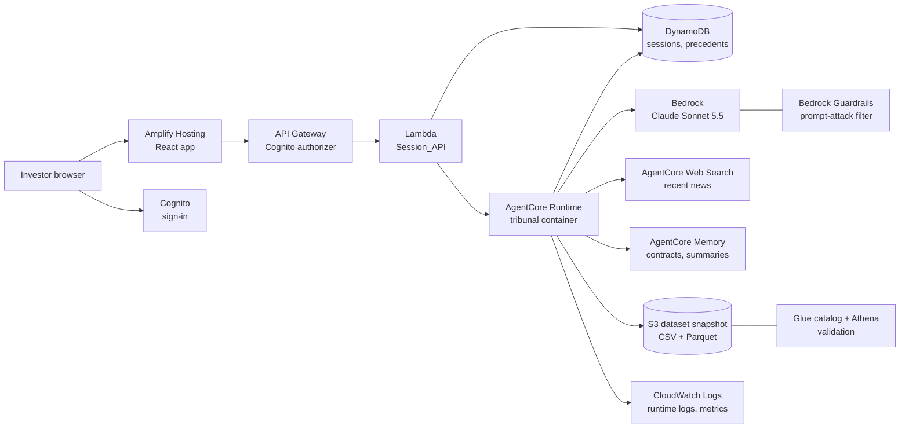

# Decision Tribunal: an agentic suitability check for investors

**Simulation only. Not financial advice, no predictions.** The app never places an order, moves money or holds credentials.

**Live demo:** https://main.d3nprpi8xxns73.amplifyapp.com (Cognito sign-in; jury credentials are sent separately). PolyFinances Datathon 2026, AlphaForge AI case (National Bank).

## The problem

An investor asks "Should I put 30% of my portfolio in Tesla?". A chatbot either says yes or refuses everything. A good advisor checks whether the request fits *this* person (horizon, risk limits, exclusions, current holdings), explains why with evidence, and says what would change the answer. The Decision Tribunal does that: AI agents argue the case, and code enforces the investor's own limits.

## How it works

1. **Investor_Contract.** The profile (persona or custom) becomes hard limits (per-holding cap, volatility, drawdown, speculative and crypto caps, sector and asset-class caps, ESG exclusion) plus soft preferences. The investor can enter their current holdings.
2. **Code checks the request** against every limit and computes the largest size that fits (`guide/tribunal/rules.py`).
3. **Advocate** (agent) states the investor's goal and proposes sizes that serve it. The code re-checks every option.
4. **Investigator** (agent) names the risks that matter for this person, citing Exhibits, including recent news found with AgentCore Web Search.
5. **Judge** (agent) weighs the preferences and chooses an option or rejects. It can never pick a size that breaks a limit; if it fails, the code rules and the screen says so.
6. **Clerk** (code) writes the ruling in plain language. A citation validator removes any number not backed by an Exhibit. A guidance-only check removes buy/sell orders and predictions. Survivorship-bias and data limits are added to every ruling.
7. **Appeal.** The investor changes one input (horizon, a limit) and the court rules again; the screen shows what changed and why.

Every number is an **Exhibit**: computed by code from a pinned dataset snapshot, with its file, column, period and processing notes, or a web article with its source and link. The UI shows a live progress card while the court sits (about a minute), then the verdict, "How the court decided" (who contributed what), the four answers, and news cards.

## Architecture on AWS



| Service | Why it is here |
| --- | --- |
| Amplify Hosting | Serves the React app over HTTPS with no server to run. |
| Cognito | Sign-in for the jury and users; tokens authorize every API call. |
| API Gateway + Lambda (Session_API) | Validates the profile and request (incl. custom holdings), starts a session, serves its live state for polling. |
| Bedrock AgentCore Runtime | Hosts the tribunal container (agents + code checks); a session runs about a minute, longer than an API call should. |
| Amazon Bedrock (Claude Sonnet 5.5) | The Advocate, Investigator and Judge. |
| Bedrock Guardrails | Prompt-attack filter on user text and on every web snippet before an agent sees it. |
| AgentCore Web Search | Recent news (last 30 days) from press, wires and regulators, shown as cited context, never used in a limit. |
| AgentCore Memory | Remembers each saved profile's contract and past rulings. |
| DynamoDB | Session state (the SessionView the UI polls) and precedents. |
| S3 + Glue + Athena | Immutable dataset snapshots (SHA-256 manifest); Glue catalogs them and Athena cross-checks row counts and duplicates at ingestion. |
| CloudWatch | Runtime and Lambda logs, custom metrics, Bedrock invocation logging. |
| IAM (CDK) | One least-privilege role per component; no keys anywhere (see below). |

All of it is CDK v2 in `infra/`; changes made by hand during the event are listed in [docs/deployment_log.md](docs/deployment_log.md).

## Results

Benchmark on the deployed system, 6 cases x 5 runs, against a single agent with the same model, Guardrail and profile ([docs/benchmark.md](docs/benchmark.md)):

| Measure | Tribunal | Single agent |
| --- | --- | --- |
| Expected verdict (computed by code) | **30/30** | 5/30 |
| Offers a lawful smaller size instead of only refusing | **20/20** | 0/20 |
| Numbers stated without evidence | **0** | several per answer, none traceable |
| Median latency | 73 s | about 5 s |

Five runs per case is indicative, not a statistical claim. Example: Robert (59, low-to-moderate risk, 3 to 5 years) asks for 30% Tesla. His request breaks 4 of his 7 limits; the court accepts a much smaller size with conditions and cites the recent Tesla news as context only. Mateo (fossil-fuel exclusion) asks for 10% Exxon: rejected.

## Data and limits

Starter dataset (Yahoo Finance prices, Bank of Canada FX and rates, FRED), 2021-11-12 to 2026-11-12, all figures in CAD, plus a hand-authored ESG exclusion list and live web news. Origin, processing, terms and limits for each: [docs/data_sources.md](docs/data_sources.md). Main limits: survivorship bias (31 assets chosen in 2026), a five-year window, about a minute per ruling, and indicative benchmark sizes.

## Documentation

| Document | Contents |
| --- | --- |
| [docs/data_sources.md](docs/data_sources.md) | Every data source: origin, retrieval, processing, limits, terms |
| [docs/benchmark.md](docs/benchmark.md) | Tribunal vs single agent: method, results, limits |
| [docs/deployment_log.md](docs/deployment_log.md) | What is live, and changes made by hand during the event |
| `.kiro/specs/agentic-investment-guide/` | Requirements, design and task list |

# Run it yourself

The rest of this page is setup: credentials, local runs, tests, deployment and the jury login.

## How AWS credentials work (read this first)

**You never create, paste, or store an AWS key or a Bedrock API key for this project.** boto3 and the AWS CLI find credentials through the [default credential chain](https://docs.aws.amazon.com/sdkref/latest/guide/standardized-credentials.html):

| Where the code runs | Credentials come from |
| --- | --- |
| Workshop / event machine (EC2) | The instance role (`WSParticipantRole`). Nothing to configure. |
| Your laptop | `aws login` or `aws configure sso`, then `export AWS_PROFILE=<profile>` if you use a named profile. |
| AgentCore Runtime and Lambda (deployed) | Their IAM execution roles, created by CDK in `infra/iam.py`. |

Only the region is configured (`us-east-1`, in `config.yaml` and `AWS_REGION`). Never put keys in `config.yaml`, `.env`, the front end, or a commit.

Check that you are signed in:

```bash
aws sts get-caller-identity      # prints your account and role
aws configure list               # access_key "TYPE" should be iam-role, sso, or a profile, never a file you edited by hand
```

### The `iam:ListServiceSpecificCredentials ... explicit deny in a service control policy` error

If you see this error in the Amazon Bedrock console, you opened the **API keys** page. That page lists long-term Bedrock API keys, which are IAM service-specific credentials. The workshop account blocks them with an organization service control policy (SCP), and nobody in the account can change that. **You can ignore the error.** The project doesn't use Bedrock API keys. It calls Bedrock with the role credentials described above.

## Prerequisites

- Python 3.11 (the repository's `.venv311` already uses it; the older `.venv` is Python 3.9 and does not work)
- Node.js 20.19+ or 22.12+ and npm (front end and the CDK CLI, run through `npx`)
- AWS CLI v2
- Docker (only for `make deploy`, which builds the AgentCore Runtime image)
- An AWS account in `us-east-1` with access to the model `us.anthropic.claude-sonnet-5-5` (Bedrock console, **Model access**)

## 1. Set up a local environment

```bash
git clone <repo-url> && cd Agent52
python3.11 -m venv .venv311          # or: uv venv .venv311 --python 3.11
source .venv311/bin/activate
pip install -e ".[dev]"
pip install -r infra/requirements.txt   # only needed to deploy or run the infra tests
(cd frontend && npm ci)
```

## 2. Check Bedrock access

This sends one Converse call through the same model and Guardrail the agents use:

```bash
python - <<'EOF'
import boto3, yaml
cfg = yaml.safe_load(open("config.yaml"))
r = boto3.client("bedrock-runtime", region_name=cfg["aws_region"]).converse(
    modelId=cfg["model_id"],
    messages=[{"role": "user", "content": [{"text": "Say OK"}]}],
    inferenceConfig={"maxTokens": 10},
    guardrailConfig={"guardrailIdentifier": cfg["guardrail_id"], "guardrailVersion": cfg["guardrail_version"]},
)
print(r["stopReason"])   # expect end_turn
EOF
```

| Error | Meaning and fix |
| --- | --- |
| `NoCredentialsError` / `ExpiredToken` | Not signed in. Run `aws login` (or `aws sso login`) and retry. |
| `AccessDeniedException ... bedrock:InvokeModel` | Your role lacks Bedrock permissions, or model access isn't enabled for the model. |
| `ValidationException ... model identifier is invalid` | Wrong region or model ID. Use `us-east-1` and the `us.` inference profile from `config.yaml`. |
| `ResourceNotFoundException` on the guardrail | The Guardrail ID in `config.yaml` doesn't exist in your account. See "New AWS account" below. |

## 3. Run the tests and one session

```bash
pytest                                            # backend, infra, and guidance-only scans
(cd frontend && npm test && npm run typecheck)    # front end

python -m guide.run_session "Robert 30% in TSLA" robert   # prints the SessionView JSON
bash scripts/run_robert.sh                                 # same run, plus schema validation
```

`run_session` reads the dataset snapshot from the S3 bucket in `config.yaml` (`s3_bucket`, default `alphaforge-guide-data`). The bucket must exist and be seeded first (see step 4), and the local cache in `.cache/dataset` only stores downloads. Any `config.yaml` value can be overridden with a `GUIDE_<KEY>` environment variable, for example `GUIDE_S3_BUCKET=my-bucket`.

## 4. Deploy to AWS

```bash
npx -y aws-cdk@2 bootstrap aws://$(aws sts get-caller-identity --query Account --output text)/us-east-1   # once per account
make deploy     # all stacks in order, then builds and publishes the front end to Amplify Hosting
make seed       # writes the dataset snapshot to S3 and the Precedents to DynamoDB
```

Extra CDK options go in `CDK_ARGS`, for example `make deploy CDK_ARGS="-c budget_email=me@example.com"`. The flags are listed in `infra/cdk.json`. `make deploy` prints the UI URL at the end. Then create the jury login (next section).

Changes made by hand in the event account (runtime image tags, guardrail, Lambda edit, Amplify uploads) are listed in [docs/deployment_log.md](docs/deployment_log.md).

`make destroy` removes every stack. The data bucket is retained on purpose; delete it by hand if you want it gone.

### New AWS account (not the event account)

The committed `config.yaml` points at resources in the event account. In a fresh account:

1. **Guardrail.** Create a Bedrock Guardrail with the settings in `infra/stacks/guardrail_stack.py` (output-only denied topics RealTransactions and ReturnPredictions, HIGH prompt-attack filter on input). Use the Bedrock console or the CLI. Then put its ID in `guardrail_id` in `config.yaml`. That stack isn't wired into `infra/app.py`.
2. **Bucket names.** S3 bucket names are global, so `alphaforge-guide-data` is taken. Deploy with a suffix, for example `make deploy CDK_ARGS="-c bucket_suffix=jdoe"`. You get `alphaforge-guide-data-jdoe` and `alphaforge-guide-athena-results-jdoe`. For local runs, set the same names:
   ```bash
   export GUIDE_S3_BUCKET=alphaforge-guide-data-jdoe
   export GUIDE_ATHENA_RESULTS_URI=s3://alphaforge-guide-athena-results-jdoe/results/
   ```
3. **Model access.** Enable the Anthropic model in the Bedrock console, then run the check in step 2.

## 5. Front end

- Deployed: `make deploy` (or `bash scripts/publish_frontend.sh` alone) builds `frontend/` and writes `config.json` (API URL, Cognito pool and client IDs, region; no secrets) from the stack outputs.
- Local dev: fill `frontend/public/config.json` with the `ApiUrl` output of `GuideApiStack` and the `UserPoolId` and `UserPoolClientId` outputs of `GuideAuthStack`. Then run `cd frontend && npm run dev` in your own terminal.
- Offline replay (no AWS): `cd frontend && npm run build:replay`, then open `frontend/dist-replay/index.html`.
- After changing `guide/tribunal/session_view.schema.json`, run `npm run gen:types`.

## Jury credentials

The deployed UI requires Cognito sign-in. After `make deploy`, create the jury account:

```bash
export DEMO_USER_EMAIL="jury@example.com"
read -rs DEMO_USER_PASSWORD && export DEMO_USER_PASSWORD
bash scripts/create_demo_user.sh
```

- The password comes only from the `DEMO_USER_PASSWORD` environment variable. It is never written to a file, committed, or logged. Give it to the jury through a separate channel.
- The Cognito password policy requires at least 12 characters with uppercase and lowercase letters, digits, and symbols.
- The script finds the user pool from the `UserPoolId` output of the stack in `AUTH_STACK_NAME` (default `GuideAuthStack`). Set `USER_POOL_ID` to skip that lookup.
- Re-running the script resets the password of the existing user.
- Region defaults to `us-east-1`.

## Repository map

| Path | Contents |
| --- | --- |
| `guide/` | Core: config, data loader, Toolkit (Exhibits), rules, agents, tribunal, `run_session` |
| `runtime/` | AgentCore Runtime entry point and Dockerfile |
| `api/` | Session_API Lambda handler |
| `infra/` | CDK v2 app (`app.py`) and stacks |
| `frontend/` | React + TypeScript + Vite UI |
| `data/` | Licensed starter dataset (seeded to S3) |
| `scripts/` | deploy, seed, destroy, publish, demo user, manual end-to-end check |
| `tests/` | pytest suite |
